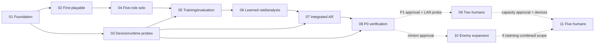

# RiftTable AR development roadmap

Version: 0.2. Date: 2026-11-02, Asia/Kuala_Lumpur. Status: **proposed roadmap; awaiting approval; implementation not started**.

This is the sequencing source of truth. Requirement authority and proposed game rules live in [SCOPE_BASELINE.md](docs/planning/SCOPE_BASELINE.md); rationale in [DECISIONS.md](docs/planning/DECISIONS.md); blockers and environment evidence in [RISKS_AND_GAPS.md](docs/planning/RISKS_AND_GAPS.md); execution status in [PROGRESS.md](docs/planning/PROGRESS.md).

Start at the [README](README.md) for the overview and [PROJECT_SPEC.md](docs/PROJECT_SPEC.md) for the consolidated player experience, scope classes and proposed P0 acceptance matrix. The [consolidation audit](docs/planning/CONSOLIDATION_AUDIT.md) records source access, proposal reconciliation and readiness. These summaries do not replace this dependency plan or turn proposed defaults into approved requirements.

## Authorization and planning assumptions

The user authorized Markdown planning, read-only inspection, and consistency checks, followed by a game README/specification consolidation (SPEC-U). Completion of these documents does not authorize PHASE-01 or adopt the proposed tier/default packs. No Unity project, game test, model, mobile build, or performance result exists in this checkout. Milestone descriptions below are future work, not achievements.

The proposed delivery split is P0: one human plus four bots, one boss, offline desktop fallback, real TensorFlow-derived boss inference, AR on both available mobile platforms, and analysis/evaluation evidence; P1: two-human cooperation; subsequent capacity: up to five humans and up to three enemies. That prioritization has not been explicitly approved. Spectator mode remains an expressed interest, with implementation and technology undecided. The original five-human intent remains in the target and traceability map; it is not represented as delivered by a solo MVP.

No calendar estimate is asserted. November 17/19 appeared in proposed briefs; contest dates, submission cutoff, team capacity, and rules are not verified. Schedule commitments follow resolution of Q03 in the risk register and measured feasibility, not the previous speculative timetable.

## Hierarchy

- **Stage:** product maturity/outcome, possibly with independently progressing branches.
- **Phase:** bounded effort with its own linked file and gate.
- **Milestone:** objectively demonstrated checkpoint within a phase.
- **Task:** unchecked, scoped work item under a milestone; task completion alone does not pass the milestone.

| Stage | Intended outcome | Phases |
| --- | --- | --- |
| S1 — Feasible platform and first playable loop | A real desktop fight and early device/runtime evidence | 01, 02, 03 |
| S2 — Complete offline party encounter | Five roles, bots, movement, preparation, and results | 04 |
| S3 — Learned boss with inspectable evidence | Canonical data pipeline and real learned control in Unity | 05, 06 |
| S4 — Single-player AR demonstration | Integrated mobile AR and a reproducible P0 release candidate | 07, 08 |
| S5 — Two-human cooperation | Tested host/client raid with controlled recovery | 09, conditional P1 |
| S6 — Remaining original capacity | Enemy envelope and five-human validation | 10, 11, conditional expansion |

## Phases, milestones, and hard dependencies

The machine-readable dependency lines in phase files use phase/milestone IDs. A dependency on a milestone allows bounded parallel work before its parent phase is fully complete. Required predecessors must pass; a written file does not satisfy a predecessor.

| Phase | Outcome and milestone sequence | Depends on | Delivery |
| --- | --- | --- | --- |
| [01 — Toolchain and project foundation](docs/planning/phases/PHASE-01-toolchain-and-project-foundation.md) | M01 approved location/toolchain; M02 clean Unity/core build and command registry | Initial user authorization; Q01 | Foundation |
| [02 — First playable combat](docs/planning/phases/PHASE-02-first-playable-combat.md) | M01 minimal tick/core; **M02 playable hero/boss fight**; M03 restart and negative cases | P01.M02; adoption of relevant B02/B03 defaults | Earliest playable |
| [03 — Device and inference feasibility](docs/planning/phases/PHASE-03-device-and-inference-feasibility.md) | M01 first-phone marker probe; M02 tiny model parity in Unity/first phone; M03 optional LAN probe; M04 remaining-platform proof | P01.M02; Q02/Q04/Q05 for compliant device claims | Early risk branch |
| [04 — Complete solo party raid](docs/planning/phases/PHASE-04-complete-solo-party-raid.md) | M01 tank/healer/resources; M02 damage roles/bots; M03 movement/full encounter contract; M04 preparation-to-results loop | P02.M03; approved B01-B04 rules | P0 core |
| [05 — Canonical training and evaluation](docs/planning/phases/PHASE-05-canonical-training-and-evaluation.md) | M01 CLI/schema/teacher; M02 train/export/parity; M03 held-out policy evaluation | P04.M03; P03.M02; approved ML/runtime contracts | P0 AI evidence |
| [06 — Learned boss and AI analysis](docs/planning/phases/PHASE-06-learned-boss-and-ai-analysis.md) | M01 runtime adapter; M02 live learned raid/failures; M03 analysis and artifact trace | P05.M03; P03.M02; P04.M04 | P0 learned loop |
| [07 — Integrated tabletop AR](docs/planning/phases/PHASE-07-integrated-tabletop-ar.md) | M01 final mat/transforms; M02 real raid/tactical recovery; M03 phone UI/content/playtest | P06.M03; P03.M01 | P0 AR loop |
| [08 — P0 verification and handoff](docs/planning/phases/PHASE-08-p0-verification-and-handoff.md) | M01 release evidence; M02 packaging/rehearsal; M03 P0 acceptance report | P07.M03; P03.M04; official rules and release targets resolved | P0 demonstration |
| [09 — Two-human multiplayer](docs/planning/phases/PHASE-09-two-human-multiplayer.md) | M01 authority/state; M02 lobby/start; M03 recovery; M04 cross-platform raid/P1 evidence | P08.M03; P03.M03; explicit P1 scope authorization | Conditional P1 |
| [10 — Enemy-count expansion](docs/planning/phases/PHASE-10-enemy-count-expansion.md) | M01 one optional minion; M02 optional second minion; M03 model/rules revalidation | P08.M03; explicit minion scope authorization; P09.M04 for multiplayer claims | Conditional 1–3 enemies |
| [11 — Five-human capacity](docs/planning/phases/PHASE-11-five-human-capacity.md) | M01 3–5 client capacity; M02 physical-device validation; M03 capacity-specific release evidence | P09.M04; additional devices; P10.M03 only if claiming minion-enabled combinations | Conditional original capacity |

## Critical paths and parallel work

Earliest playable: **approval → P01.M01 → P01.M02 → P02.M01 → P02.M02**. This is a functioning conventional-camera fight, not the completed AR/ML product. A visible scripted-development label is required until learned inference is integrated.

P0 delivery path: **01 → 02 → 04 → 05 → 06 → 07 → 08**, with the **03 device/runtime branch joining before 05/06 and 07**. If tool installation, signing, marker permission, or runtime proof fails, that branch can become the actual critical path. Dataset training cannot precede stabilization of the five-role simulation contract.

P01 only gates desktop Unity/.NET readiness. Python/mobile tooling proceeds in 03. P03.M01/M02 on the first viable phone unlock integration and final-model work; remaining-platform proof P03.M04 can finish alongside it, but is required before P07.M03 and P08 accept the proposed two-platform scope. P04.M03 freezes core rules for 05 while P04.M04 UI finishes; 06 waits for both model evidence and that complete UI flow.

P1 path: P0 gate → 09, with the small P03.M03 connection probe already completed. Enemy expansion 10 and five-human capacity 11 are independently gated after their stated prerequisites. P0 does not depend on 09–11. P1 base-two-phone completion does not depend on minions.

Phase-level view (the milestone dependency lines are more precise; dashed edges are conditional scope):



Parallelizable work after P01.M02:

- Desktop slice 02 and device/model probes 03 share only stable minimal contracts; neither needs the other's completed implementation.
- Original/appropriately licensed miniature art, mat drafting, icons, and UI wireframes can be prepared against B01/B04 while simulation work proceeds. Import/quality acceptance belongs to 07; art production is not allowed to block 02.
- Evaluation scenario design can accompany 04, but final examples/labels are generated only from its accepted canonical rules.
- Once 05 has a verified artifact, inference integration and analysis UI tasks within 06 can proceed independently against the decision-record contract.
- In expansion, five-client tooling and minion content may proceed independently after their prerequisites. Any combined release requires both relevant validation sets.

Work that cannot start: implementation before user authorization; bootstrap before the location decision; contest runtime commitment before Q02; final model training before simulation/schema lock; physical alignment claims before measurements; P1/P2 features before their scope gate. Bounded compatibility probes may use a declared provisional adapter while Q02 is unanswered, without claiming contest compliance.

## Proposed integration boundaries

After authorization/location approval, use a new `RiftTableAR/` subtree as the recommendation, preserving the root documentation. The user authorized removal of the legacy StudySmart notebook/README content and then creation of a new game README on 2026-11-02; neither action authorizes bootstrap or settles the destination. An external repository is an alternative that needs an explicit destination; do not write outside this workspace implicitly.

| Boundary | Proposed responsibility |
| --- | --- |
| `RiftTableAR/Simulation/Core/` | One canonical pure-C# core; Unity-compatible API surface, fixed ticks, commands, state, target/geometry rules, policies/events |
| `RiftTableAR/Simulation/Tests/` | Headless behavioral tests using the same core source |
| `RiftTableAR/Simulation/SimCli/` | Persistent versioned NDJSON interface, batch data generation and evaluation stepping |
| `RiftTableAR/Unity/` | Local-package consumption of the same core, conventional/AR cameras, presentation, UI, input, inference and networking adapters |
| `RiftTableAR/MachineLearning/` | TensorFlow training, exported-model inference for evaluation, manifests, scenario splits and figures |
| `RiftTableAR/Printables/` | Final measured marker/mat and print instructions |
| `RiftTableAR/Evidence/` | Small versioned reports/manifests; bulky local logs/builds stay outside tracked source unless intentionally selected |

These paths are proposed and absent. P01 must prove core consumption in Unity and .NET without copying rules. Prefer a local Unity package and a .NET project compiling its Runtime source; validate the package path/API profile there. No generalized service framework, ECS rewrite, physics simulation dependency, custom engine, database, player account service, or spectator server is required for P0.

Use one simulation authority even in solo. Rendering reads state/events; input creates validated commands; inference chooses legal action categories. Clock/decision IDs accompany observations and executed actions. The model/teacher see the same observation, while deterministic target selection may inspect full state. AR calibration transforms only presentation and input mapping. Networking, when enabled, transports accepted commands/snapshots/events and never shares phone-specific AR origins.

Persistence is local settings, model/evaluation manifests, decision logs and selected evidence only. Save-game progression, cloud saves, inventories, accounts, and persistent match resumption are not requested. A process exit ends an encounter; reconnecting to a still-running host is a different P1 capability.

## Verification commands and evidence rules

**Confirmed now:** repository inventory, `git status --short`, Python standard-library inspection, `xcode-select -p`, and Markdown read/consistency checks. `xcodebuild -version` failed because only Command Line Tools are selected. There is no confirmed working game-test command or game-test infrastructure. Do not count zero discovered tests as validation.

**Proposed commands, not executed and not yet runnable:** P01 must establish actual paths/versions, register commands in this section, and prove that failures yield nonzero exit codes and tests are discovered.

```sh
# P-DOTNET: proposed after its project and SDK exist
dotnet test RiftTableAR/Simulation/Tests/RiftTable.Core.Tests.csproj --configuration Release

# P-PYTEST: proposed after an isolated compatible Python environment exists
RiftTableAR/MachineLearning/.venv/bin/python -m pytest RiftTableAR/MachineLearning/tests -q

# P-UNITY-EDIT: proposed; UNITY_EDITOR must be the verified executable path
"$UNITY_EDITOR" -batchmode -nographics -projectPath "$PWD/RiftTableAR/Unity" -runTests -testPlatform EditMode -testResults /tmp/rifttable-editmode.xml -logFile /tmp/rifttable-editmode.log

# P-UNITY-PLAY: proposed; rendering/device behavior still needs interactive testing
"$UNITY_EDITOR" -batchmode -projectPath "$PWD/RiftTableAR/Unity" -runTests -testPlatform PlayMode -testResults /tmp/rifttable-playmode.xml -logFile /tmp/rifttable-playmode.log
```

Data-generation/training/evaluation CLI commands are intentionally not invented as already available. Define and document their executable arguments at P05.M01/M02; acceptance then requires exact commands, versions, seeds, exit status, discovered-test counts, and artifact hashes. Automated non-graphical success never proves mobile rendering, signing, AR accuracy, thermals, or physical multiplayer.

Completion gates require relevant automated behavior tests, manual scenario steps, evidence, no unresolved blocker in the affected scope, and a handoff record. Future implementations may continue within the user's authorized phase range once these gates pass; an extra permission ceremony is not required for each routine task. Conditional feature branches and material scope changes need explicit authorization. This planning turn authorizes no phase.

## Requirements-to-phase traceability

Statuses and wording are authoritative in the scope baseline. Proposed rows are traceable work only if adopted; this table does not approve them.

| Requirement | Primary implementation | Verification / accounting |
| --- | --- | --- |
| R01 | 03, 07 | 08 mobile AR gate |
| R02 | 04 | 04 full-party scenarios; 08 |
| R03 | 09, 11 | 09 two-human subset; 11 full five-human target |
| R04 | 04, 10 | 04 one boss; 10 optional minions/max-three envelope |
| R05 | 03, 05, 06 | 08 actual learned mobile decisions and compliance evidence |
| R06 | 04, 07 | 07 measured physical spawn mapping; 09 same assignment |
| R07 | 02, 04 | 07 scanning negative cases; 09 host-only synchronized start |
| R08 | 04 | 08 one human/four bots |
| R09 | 04 | 04 real abilities; 07 two-button mobile HUD |
| R10 | 02, 04 | 07 physical-view input tests |
| R11 | 04 | 05 rules-compatible datasets; 08 balance/playtest |
| R12 | 02, 04 | 04 resource/target/death/interrupt tests |
| R13 | 01, 02, 04 | 05 canonical CLI; 09 single host authority |
| R14 | 04 | 09 lobby revisions/countdown/disconnect |
| R15 | 03, 07 | 07 measurement protocol; 09 cross-device alignment |
| R16 | 07 | 08 interruption scenarios; 09 local tracking versus disconnect |
| R17 | 02, 04, 06 | 08 offline launch and tactical view |
| R18 | 03, 07 | 08 separate iOS/Android gates |
| R19 | 05, 06 | 05 teacher/input parity; 06 action validation |
| R20 | 05 | 06 golden observations; 08 reproducibility package |
| R21 | 05, 06 | 08 recorded decision and result walkthrough |
| R22 | 03, 05, 06 | 08 fallback/missing-evidence labeling; all phase gates |
| R23 | 04, 07 | 08 phone usability/error-state review |
| R24 | 04, 07 | 08 provenance and real-device rendering |
| R25 | 03, 07, 08 | 09 network metrics; 11 capacity metrics |
| R26 | 05, 06, 08 | 08 settings/log persistence and reset inspection |
| R27 | 09 | 09 ownership, reconnect, host-loss tests |
| R28 | 08 | 09/10/11 incremental release reports only for enabled scope |
| R29 | 01 | All phase preservation checks and planning authorization boundary |
| O01–O05 | No implementation assigned | Optional/deferred proposal register in scope; new approved phase needed before work |

## Roadmap audit

- Every R01–R29 row has implementation/evidence ownership; optional ideas are explicitly accounted for rather than silently scheduled.
- Dependency direction is acyclic: P0 01/02/03/04/05/06/07/08; conditional 09/10/11 never block P0. P10 model refresh reuses P05 tooling inside P10; it does not create a backward dependency on re-completing P05.
- First playable is P02.M02. UI, rules, meaningful negative tests, and inspection are integrated from 02 onward. Early 03 probes expose signing, AR and inference risks before final training/content investment.
- P0 gate excludes the optional multiplayer Gate C. Two-platform single-player tests and a two-platform simultaneous match are different evidence.
- Assistant-only defaults, spectator technology, deployment destination, tool installation and external contest facts remain visible decisions/gates. No previous pasted 'start executing now' instruction overrides the current planning-only boundary.
- Calendar dates, speed of implementation, achieved performance, accuracy, and mobile compatibility have not been fabricated. Record actual planning-check results in PROGRESS.md after audit.

Read-only planning audit on 2026-11-02 passed: 17 authorized Markdown files, 11 phase files, 35 uniquely identified milestones, 105 unchecked implementation tasks, 29 traced requirements, and 104 valid local links/anchors. Milestone predecessors including conditional branches are acyclic; P0 excludes optional network probe/P1/P2 work and retains the remaining-platform gate. Both original source hashes matched before the later user-authorized legacy cleanup. These are documentation checks, not application test results. The cleanup removed only the StudySmart notebook/README and updated their obsolete preservation instructions; no game phase was started.
