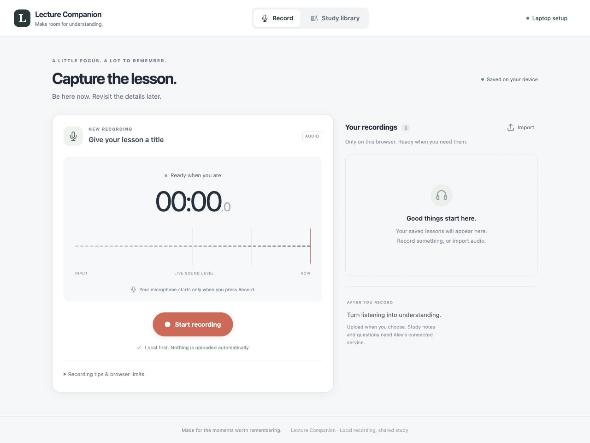
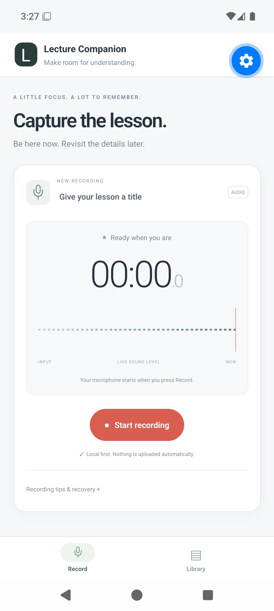
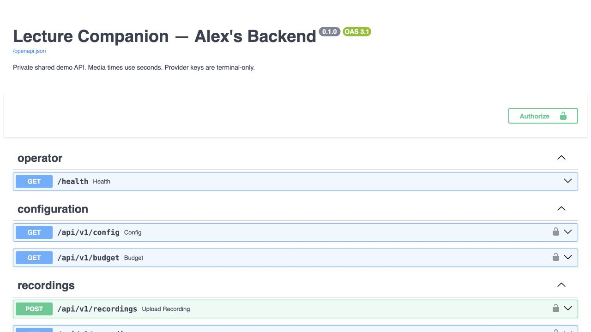

# Lecture Companion

Working descriptor for an IGCSE study app: record or import a lesson, save its transcript, produce lecture-grounded notes and an overview, then answer questions with source-linked feedback. ElevenLabs handles transcription; an external LLM initially generates study materials. Two independent TensorFlow/Keras neural networks for subject and language recognition are implemented in [`training/`](training/); training on reviewed real lectures is pending the dataset.

**Status: recording-first web and native Expo frontend source, plus Alex’s initial backend, are implemented.** The web adapter now matches the backend's CSRF, budget and quiz-result fields. A browser recording→upload→processing→scoring/deletion flow is verified against the real API/worker with isolated data and labeled provider doubles. The Android interface launches in native Expo Go and Record/Library navigation is verified in an emulator. Native API integration, standalone builds, physical-phone tests and long-session/endurance tests remain pending. Alex separately verified one short real-provider run; no new paid frontend/provider run is claimed. **The subject and language CNNs and Colab/Jupyter notebook are created and pass synthetic training checks.** Real-lecture accuracy and live model integration remain pending; see [training status and instructions](#train-the-subject-and-language-networks).

## Screenshots

Captured locally on 6 November 2026. The website and API images show the running laptop services; no provider request was made for these screenshots.

| Website — recording screen | Mobile app — Android emulator |
| --- | --- |
|  |  |

The mobile image is an unmodified screenshot from the running Expo [`App.tsx`](apps/mobile/App.tsx) in **Expo Go 58.0.5 on an Android 16 / API 36 ARM64 emulator** (Pixel 6 profile, 1080 × 2400). The real native modules are loaded; Record → Library → Record navigation and the empty local library were checked. Expo Go's floating developer-tools button is visible. This verifies native launch and navigation; standalone development builds, iOS, physical microphones, background capture, endurance and native backend integration remain unverified. See [Ben's native emulator evidence](docs/specs/BEN_FRONTEND_SPEC.md#14-native-android-emulator-checkpoint--6-november-2026).

**Backend API — live Swagger documentation**



## Run locally

The frontend is **[http://127.0.0.1:5173/](http://127.0.0.1:5173/)**. The API documentation is [http://127.0.0.1:8000/docs](http://127.0.0.1:8000/docs). Both services run on Alex’s laptop; they are available while their server terminals are running.

Use Node 24, Python 3.13, `uv`, and FFmpeg/ffprobe on your PATH. From the repository root, install the pinned dependencies once:

```sh
uv sync --frozen
npm ci
```

**Terminal 1 — start the backend without paid providers:**

```sh
env -u ELEVENLABS_API_KEY -u OPENAI_API_KEY ./scripts/start_demo.command --no-prompt
```

Leave this terminal running. It prints a **demo connection code** for browser access. This command clears inherited provider keys, makes no paid startup request, and retains the existing database and shared US$20 spending ledger under `var/demo/`.

**Terminal 2 — build and start the frontend:**

```sh
npm run build
npm run preview --workspace apps/web -- --port 5173 --strictPort
```

Leave this terminal running and open **[the frontend](http://127.0.0.1:5173/)**. For development, `npm run dev` also serves the app on port 5173. Run these commands from the same checkout as Terminal 1. Stop a service with Ctrl+C in its terminal; restart it if the browser reports “connection refused.” If port 5173 is already serving this app, use that instance rather than starting a second one.

### Connect this browser to the backend

1. Open [browser access setup](http://127.0.0.1:8000/operator/connect) in the same browser/profile as the frontend. Enter the **demo connection code** printed by Terminal 1 and select **Connect**. Provider API keys belong only in the backend’s private terminal prompt.
2. Open [the frontend](http://127.0.0.1:5173/), select **Connect laptop** (or **Laptop setup**), and enter `http://127.0.0.1:8000` as the laptop service address. Select **Connect**.
3. Confirm that **Study library** shows the uploaded lectures and demo allowance. The browser retains the host setting and access cookies; repeat provisioning after clearing cookies or using a different profile.

Use `127.0.0.1` for both links so the access and CSRF cookies share the hostname. The backend already allows this local frontend origin. Phone access needs a separate trusted LAN/HTTPS setup; localhost on a phone refers to that phone.

### Record, upload, and study

The **Record** screen works without the API. Allow microphone access when you choose **Start recording**, use Pause/Resume as needed, then select **Stop & save**. Open the saved recording for playback/export. Browser capture is foreground-only: keep the page visible and export important audio because browser storage can be evicted.

To upload, select **Use for study**, review the file/title, acknowledge the shared-library scope and select **Upload to shared library**. Uploading does not start a paid request. Every authorized demo browser sees the same uploaded library.

With paid providers disabled, selecting **Process lecture** safely blocks at the missing-provider stage; fresh transcription, notes and quiz generation cannot run live. Existing generated lectures remain readable and their quizzes can still be scored locally for free. The saved **Live E2E — synthetic photosynthesis narration** is a previously generated example, not a new provider result.

For an explicitly authorized live provider run, stop Terminal 1 and run `./scripts/start_demo.command`, entering keys privately at its hidden prompts. Merely starting the server does not spend money; processing uses the persistent shared allowance. Do not enter provider keys in the frontend, README, chat or `.env` files.

### Test the complete flow with zero paid calls

The automated flow uses a synthetic WAV microphone, real browser recording/export/upload, and the actual API/worker with **labeled test providers in temporary storage**. It verifies budget display, correct/incorrect/unanswered quiz scoring and deletion. External provider HTTP is blocked. It does not switch the deployed backend to fake providers or use its real study database.

With the frontend already running on port 5173, run:

```sh
npx playwright install chromium
LECTURE_WEB_TEST_URL=http://127.0.0.1:5173 PLAYWRIGHT_CHANNEL=chromium npm run test:browser --workspace apps/web -- --grep 'recorded WebM'
```

This targets the deployed frontend and starts a disposable test API on a separate localhost port; its private test browser connects to that API. Your normal browser remains connected to port 8000. `PLAYWRIGHT_BROWSERS_PATH` may select an existing project-local browser installation. Omit `LECTURE_WEB_TEST_URL` to test against the automatically started development server on port 4173.

Other verification commands are `npm run typecheck`, `npm run typecheck:mobile`, `npm test`, `npm run test:contract`, `.venv/bin/pytest -q`, and `npm run test:browser` for the full browser suite. Contract/browser API tests require the backend `.venv`, or `LECTURE_TEST_PYTHON` pointing to that environment. Google Chrome is the browser-suite default; set `PLAYWRIGHT_CHANNEL=chromium` for Playwright’s installed Chromium.

The native iPhone/Android source is in `apps/mobile/`; start its development server with `npm run mobile`. With an Android emulator running and its SDK tools on PATH, `npm run start --workspace apps/mobile -- --go --localhost --android` opens the app in the matching native Expo Go client. Local development builds use `npm run ios --workspace apps/mobile` or `npm run android --workspace apps/mobile` after platform tooling/device provisioning. Standalone native builds, iOS installation, actual phone microphones, Safari, long-session/endurance and recovery guarantees remain unverified. See [Ben’s emulator checkpoint](docs/specs/BEN_FRONTEND_SPEC.md#14-native-android-emulator-checkpoint--6-november-2026).

The active specification set has three owners:

| Owner | Specification and authority |
| --- | --- |
| Alex — backend and integration | [Backend, processing and AI integration](docs/specs/ALEX_BACKEND_SPEC.md): shared requirements/defaults, canonical API, model/data, budget/credentials, delivery gates and remaining decisions |
| Ben — mobile and web frontend | [Functional frontend](docs/specs/BEN_FRONTEND_SPEC.md): iPhone/Android/web recording/import, local library, API integration, study/quiz UI and recovery |
| Michelle — interface design | [Mobile and web interface design](docs/specs/MICHELLE_INTERFACE_DESIGN_SPEC.md): information/interaction design, tokens/components, screen states, accessibility and implemented usability review |

Confirmed operating choices: Alex owns backend/integration and Ben owns frontend; support iPhone/iOS and Android; normal recordings last 30–60 minutes with a ten-hour maximum; host/save the demo on Alex’s current laptop; control total API usage within US$20; enter provider keys privately through the implemented terminal launcher. Use latest stable compatible packages at setup, then pin verified versions.

The merged contract uses `/api/v1/recordings`, `/config`, `StudyPack` and seconds for media times. Authorized demo devices share one controlled uploaded library; unuploaded originals remain local. Build a short real end-to-end slice first while retaining normal/max-duration and browser-recording requirements in the full target. A baseline/fallback is never presented as the team’s trained model.

[AGENTS.md](AGENTS.md) defines working rules. The [premerge source archive](docs/planning/archive/lecture-companion-premerge-2026-11-04/MERGE_SOURCES.md) preserves both document sets; the [RiftTable archive](docs/planning/archive/rifttable-ar-2026-11-04/ARCHIVE.md) remains historical. The previously deleted StudySmart notebook is not restored. Archived plans/APIs/instructions are not active authority.

## Backend details

Backend versions are pinned in `pyproject.toml` and `uv.lock`; frontend versions are pinned in `package-lock.json`. The local data directory is `var/demo/`, including audio, SQLite state and content-free spending records. Local data, provider keys, app-access provisioning, dependency directories and generated builds are excluded from Git. Restarting or deleting study data does not reset spending.

The active verified backend intake limit is **60 minutes and 128 MiB**. Ten hours/2 GB remain full targets and are shown separately in `/config` as `prototype_limited`. WAV, MP3, M4A/AAC and WebM/Opus are supported; browser WebM without duration metadata is measured by a bounded local decode. There is no verified ten-hour/device endurance claim. The CNN implementation and training environment are separate from the API runtime. A real-lecture-trained subject bundle is not installed in the live worker; missing custom inference remains explicitly unavailable.

Backend checks and contract export:

```sh
.venv/bin/pytest -q
.venv/bin/ruff check services scripts tests
.venv/bin/python scripts/export_contract.py
```

The generated [OpenAPI contract](fixtures/contracts/openapi.json) comes from the implementation. [Alex’s spec](docs/specs/ALEX_BACKEND_SPEC.md#14-backend-implementation-and-local-operation) owns backend behavior/limits; [Ben’s integration checkpoint](docs/specs/BEN_FRONTEND_SPEC.md#13-api-integration-fixes--6-november-2026) records web verification. API/worker source is under `services/api/lecture_backend/`. Provider keys are entered only through the launcher and are never saved by default or sent to the frontend.

## Train the subject and language networks

**Implemented on 8 November 2026:** two independent character CNNs, training/evaluation commands and [Lecture_Classifier_Training.ipynb](training/Lecture_Classifier_Training.ipynb) for Colab/Jupyter. Both networks learn from random weights using TensorFlow/Keras. No pretrained embeddings, BERT, fastText or LLM classifier is used. [Alex's training section](docs/specs/ALEX_BACKEND_SPEC.md#9-model-training-evaluation-and-deployment) remains the owner of requirements and evidence.

| Network | Architecture | Output |
| --- | --- | --- |
| Subject | Character vocabulary → Embedding → Conv1D → GlobalMaxPooling → Dense → Dropout | Softmax; one subject per instructional section |
| Language | Separate character vocabulary and CNN with its own weights | Independent sigmoid labels; English/Malay/Chinese can co-occur |

**Real lecture training is pending the dataset.** The initial run trained both networks only on explicitly synthetic software-check examples. Those results verify the pipeline; they do not establish lecture recognition accuracy and cannot be loaded as the production subject classifier. No provider API was called or model deployed.

For a new local checkout, create the isolated training environment once (Python 3.13):

```sh
uv venv --python 3.13 var/training-env
uv pip sync --python var/training-env/bin/python --require-hashes training/requirements.txt
var/training-env/bin/python -m training.train templates var/training-data
mkdir -p var/training-data/transcripts
```

For local notebook use, select `var/training-env/bin/python` as the kernel interpreter in your Jupyter editor. In a fresh Colab runtime, follow the notebook's repository setup and dependency-install cell first.

On Alex's current checkout that environment and the two header-only CSV templates already exist. Put original-language UTF-8 `.txt` transcripts in `var/training-data/transcripts/`. To create fresh unlabelled annotation drafts, run:

```sh
var/training-env/bin/python -m training.train prepare var/training-data/transcripts var/training-data/drafts
```

Review the draft rows yourself: `source_index.json` maps each lecture ID back to its original file for context. Subject sections need `role` and `subject`; language sections need independent `English`, `Malay`, `Chinese` 0/1 labels. Assign `train`, `val`, `test` before training; all derivatives of one source share a `source_family_id` and split. Only instructional sections train the initial subject model. Draft splitting does not determine teaching context or labels. The notebook explains the columns and limitations. If you prepare and label drafts in `var/training-data/drafts/`, set its `DATA_DIR = ROOT / 'var/training-data/drafts'` before running; keep `RUN_MODE='real'`. Raw data, models and executed private notebooks belong under ignored `var/`, not Git.

Once reviewed CSVs are ready (choose fresh output directories for every run):

```sh
var/training-env/bin/python -m training.train validate subject var/training-data/drafts/subject_segments.csv
var/training-env/bin/python -m training.train train subject var/training-data/drafts/subject_segments.csv --output var/models/subject-run-001
var/training-env/bin/python -m training.train validate language var/training-data/drafts/language_segments.csv
var/training-env/bin/python -m training.train train language var/training-data/drafts/language_segments.csv --output var/models/language-run-001
```

Each export includes `model.keras` with its trained vectorizer, a versioned manifest, validation-selected thresholds, source/split hashes, training history, held-out metrics, a comparison baseline, plots, reload-parity verification and a source snapshot. Subject exports match the existing 1000-character serving interface; language exports are separate and are not connected to the public API yet. All require human review before live deployment. Language scores indicate text presence, not speaking-time percentages or identification of a spoken Chinese variety.

**Verification:** 15 automated training tests pass, and a private synthetic-mode notebook execution trains both default networks, exports them and verifies reload predictions. These are software checks, not real-lecture validation.

Run `var/training-env/bin/python -m pytest training/tests -q -o pythonpath=.` for the training tests. To repeat the **synthetic-only** end-to-end check, use fresh paths with `var/training-env/bin/python -m training.smoke --data-dir var/SYNTHETIC-check-002 --output var/models/SYNTHETIC-check-002 --epochs 8`. These artifacts are marked ineligible for production. Neither command calls ElevenLabs/OpenAI or changes the live demo's data/budget. Use the notebook's `RUN_MODE='real'` for actual reviewed lectures; it blocks on empty/unreviewed CSVs instead of inventing labels.

## First real-provider test

A locally synthesized 60.02-second photosynthesis narration completed through ElevenLabs Scribe v2 and GPT-6 Luna in 22.85 seconds. It produced a transcript (1.24% word error rate against the known script), three note sections and four evidence-linked MCQs. Correct-answer scoring returned 100%; two correct, one wrong and one unanswered returned 50%; repeating the submission reused its attempt.

The conservative ledger total was **US$0.071294** under a temporary cumulative **US$2** request cap. The regular US$20 ceiling was restored with charges retained and no outstanding/uncertain reservations. This is conservative accounting, not an invoice claim. Results/audio remain locally under `var/e2e/live-short-sample/`; the shared demo library retains the labeled synthetic recording. `scripts/run_live_e2e.py` is an opt-in localhost runner; it never reads provider keys and rejects a repeat of a passed run by default.

Content review found answer-position bias (all four correct options were A) and raw evidence IDs in overview prose. Both are fixed for newly published packs: the backend shuffles/balances correct-answer positions and relabels options with the matching frozen key, while overview citations remain only in structured evidence fields. Existing scored packs, attempts and raw provider checkpoints remain unchanged. Subject classification used the labeled external baseline; no custom model was tested.

The follow-up verification replayed that saved output entirely offline: all four answer positions are distinct, the overview has no inline IDs, and scoring still returns 100%/50% for the two checks. **55 tests pass**, with external HTTP blocked during tests; spending remains US$0.071294 with no new provider requests. The original real-provider test is not rerun. Stop/restart the launcher to load source changes into an existing server and re-enter keys privately if needed; keys are not extracted from the running process. Local replay evidence is under `var/e2e/offline-quality-fixes/`.
