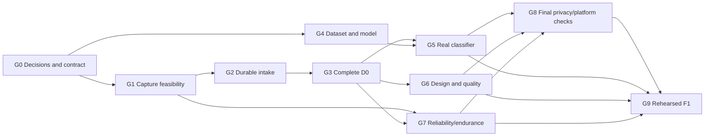

# Lecture Companion implementation sequence

2026-11-04 · Proposed execution order, not coding authorization or a calendar commitment.

[Scope/defaults](docs/planning/SCOPE_BASELINE.md) own requirement status; [PROJECT_SPEC.md](docs/PROJECT_SPEC.md) owns product/acceptance behavior; workstream specs own their detailed responsibilities. This is the only active sequencing plan. The former game phases are historical in the [archive](docs/planning/archive/rifttable-ar-2026-11-04/ARCHIVE.md).

## Workstreams and first deliverable

The user is Alex, responsible for backend/integration and the demo server/data on his current laptop. Ben develops the functional iPhone/iOS + Android and web interfaces, Michelle the visual system, and the shared ML team the classifier. First produce D0: a real short recording/import flowing through saved transcription, notes, lecture overview and scored questions. Model work proceeds independently; integration waits for an agreed input/output contract and a valid model bundle. Michelle receives working components early and preserves their behavior.

The first end-to-end path can label the classifier as disconnected. F1 requires genuine trained inference and the full adopted reliability/platform contract, including the ten-hour target. No optional dialogue analysis or commercialization work precedes a complete baseline without a scope decision.

## Confirmed operating constraints

Typical recordings are 30–60 minutes, with a ten-hour absolute audio maximum. Host the API/worker/database/media locally on Alex’s current laptop; both phones use a trusted LAN/hotspot address. Use latest stable compatible package releases at setup, then pin them. The combined total API allowance is US$20 across providers, including retries, managed by a persisted ledger. Specify a no-echo terminal launcher for Alex to supply provider keys to backend processes. No keys, paid calls, script or service are created by this documentation task.

## Dependency gates

Every item below is unstarted. A gate passes only with its listed evidence. These are dependency milestones across workstreams, not a replacement for the four person-oriented specialist specifications.

| ID | Outcome / work | Dependencies | Responsible | Exit evidence |
| --- | --- | --- | --- | --- |
| G0 | Adopt bounded implementation scope/source location and shared contract; resolve remaining rubric/framework/data/account details within confirmed host/platform/budget choices | Explicit implementation instruction; remaining Q01–Q08 relevant to the slice, Q16 | Alex/team | iPhone + Android, current laptop/local data, US$20 and terminal key entry recorded; selected defaults, contract/fixtures and account readiness reviewed |
| G1 | Foundation and early recorder feasibility | G0 | Ben/Alex | Latest stable compatible toolchain resolved and pinned; laptop capacity/LAN inventory; actual iPhone + Android capture/pause/stop/recovery probe and desktop import; observed background/codec limits; no ten-hour claim |
| G2 | Durable session/intake pipeline | G1 and shared contract | Alex/Ben | Saved local library, laptop-hosted checksummed intake/storage, private workspace access, persisted job/status and shared US$20 reservation ledger; terminal launcher contract verified during authorized setup |
| G3 | Complete D0 workflow | G2 | Alex/Ben | Real ElevenLabs transcript, source-linked notes/overview/quiz, deterministic marking and failed-stage retry; classifier visibly unavailable if not ready; A01–A03 baseline |
| G4 | Dataset and ML baseline | G0 taxonomy/data permissions; independent of G2/G3 completion | Shared ML lead/reviewer | Reviewed independent source groups, split manifest/leakage audit, baseline comparisons and frozen evaluated TensorFlow bundle |
| G5 | Real classifier integration | G3 + G4 | Alex/ML lead/Ben | Serving parity, accepted/abstained/failed/unavailable UI, manual override provenance and independent actual inference; A04 |
| G6 | Design, educational quality and revision integrity | G3; begins earlier against fixtures | Michelle/Ben/Alex | All agreed screens/states styled without regressions; human review, source/answer validation, stale revisions and frozen attempts; A05/A06 |
| G7 | Full reliability, media and endurance | G1 feasibility + G3; final model branch uses G5 | Ben/Alex | Full 30-min and 60-min recordings on both iPhone and Android, background/interruption/restart/upload recovery, original-time transforms, bounded laptop resources and real-time ten-hour capture on both; no automatic paid endurance transcription; A03/A08 |
| G8 | Privacy/usage and platform verification | G3 access baseline; G5–G7 for final integration | Alex/QA owner/Ben | Two-workspace isolation, terminal-secret handling, deletion during work, US$20 ledger persistence/reservation race tests with synthetic costs, iPhone + Android/laptop/browser matrix and measured timings; A07/A09 |
| G9 | Rehearsed F1 handoff | G5 + G6 + G7 + G8 | Entire team | A01–A10 evidence, real model artifacts/results, repeatable live and labeled saved demos, presentation/teacher-rule review and remaining limitations |

Suggested parallelism is work allocation, not permission to spawn coding agents. G4 dataset/model work and G1–G3 app work can proceed together after their relevant decisions. Design concepts/fixture styling can proceed alongside functional development; final design acceptance waits for actual flows. Start the recorder feasibility branch early because a late background/ten-hour failure can change platform scope.

## Workstream handoff contracts

| Handoff | Concrete reviewable result |
| --- | --- |
| Alex ↔ Ben | Adopted OpenAPI/typed object contract and realistic success/failure fixtures, version/retry semantics, working local integration |
| Ben → Michelle | Functional components, required states/callbacks/semantic hooks and screen list; design tokens independent of behavior |
| ML team → Alex | Model+preprocessor+labels+threshold bundle, signatures/hashes, fixed parity samples and held-out report |
| Alex → Ben | Source-linked artifacts and quiz public/private response boundaries; stable asynchronous status and deletion behavior |
| Team → presentation owner | Actual screenshots/builds, input samples, model/data/prompt versions, measurements and honest limitations |

Proposed future source layout, once location/implementation are authorized: `apps/mobile/`, `apps/web/`, `services/api/`, `services/worker/`, `packages/contracts/`, `ml/`, `tests/`, `fixtures/`. These paths do not currently exist and are not runnable commands. Do not install dependencies or create them in this documentation task.

## Requirement traceability

| Requirements | Delivery gates | Acceptance |
| --- | --- | --- |
| LC-01 | Documentation replacement complete | Source audit/archive verification |
| LC-02/03/13/17 | G1/G2/G3/G7/G8 | A01/A08/A09 |
| LC-04/18 | G2/G3/G7 | A03/A08 |
| LC-05/06/07/08/10 | G3/G6 | A02/A05/A06 |
| LC-09/14/20/22 | G4/G5/G8/G9 | A04/A09/A10 |
| LC-11/21 | G2 baseline; G8 complete | A07 |
| LC-12/23 | G0 allocation; G6/G9 | A10 and functional design review |
| LC-15/16 | G1 feasibility; G7 | A08 |
| LC-19 | G2 contracts; G6/G8 | A05/A06/A07 |
| LC-24/25/26 | Not activated; separate scope decision | New task-specific gates required |

## Scheduling and completion rules

No verified deadline, team capacity or effort estimate exists. After Q01/Q14, size milestones against actual availability. If event time only permits D0, say so explicitly and report ML/endurance gaps; do not redefine D0 as full F1 or assume it meets the contest rubric. Favor a working complete short path over a collection of disconnected screens.

Record actual checks and limits in [PROGRESS.md](docs/planning/PROGRESS.md). A milestone can be specified, implemented/unverified, automatically checked, device checked and demonstration ready; these are different evidence dimensions. Do not mark G9 complete from source files or short simulated endurance alone. Scope or contract changes update the baseline, decisions, affected specialist docs and evidence before changing the completion claim.
