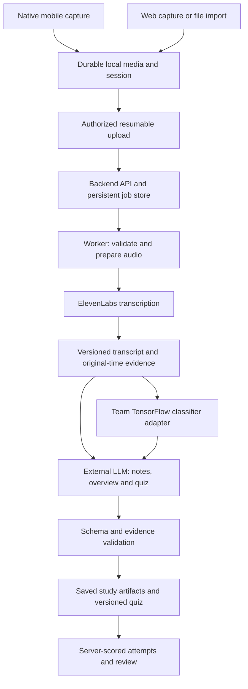

# IGCSE Lecture Companion: full implementation specification

Version 0.2 · 2026-11-04 · Detailed design for review, not implementation authorization.

The user has replaced RiftTable AR with this project. This document specifies the complete intended study prototype and its smaller initial demonstration. It incorporates the Steven/Alex/Ben meeting and user-authored context in the attached prior discussion. The [scope baseline](planning/SCOPE_BASELINE.md) owns requirement status and proposed configuration; [clarifications](planning/RISKS_AND_GAPS.md) identify decisions still required. Technical recommendations below remain proposals unless recorded otherwise in the [decision register](planning/DECISIONS.md).

## 1. Purpose and product boundary

Help an IGCSE student turn a real lesson into material they can review and use to test their understanding. A successful session preserves the original recording, saves a navigable transcript, identifies the subject with the team's trained model when available, produces useful lecture notes and a lecture overview, and offers questions with feedback grounded in that lesson.

The product has three distinct AI responsibilities:

| Component | Initial responsibility | What the team must be able to demonstrate |
| --- | --- | --- |
| ElevenLabs speech-to-text | Convert audio into text and available timing/speaker data | Real API integration and saved transcript; not described as a team-trained recognizer |
| Team TensorFlow/Keras model | Classify transcript content into an agreed subject taxonomy, with uncertainty/abstention | Reviewed data, training code/history, frozen model and preprocessing, held-out evaluation, real inference |
| External LLM, initially OpenAI API candidate | Generate lecture notes, lecture overview and questions from transcript evidence | Versioned request/schema, validated saved output, provider provenance and real examples |

The first milestone joins recording/import through study outputs before the trained classifier is connected. That is a deliberate integration sequence, not the final AI deliverable. Later the team may train additional models to replace specific tasks, but subject classification is the agreed first trainable function. It does not by itself generate prose, infer student mastery, or replace transcription.

Commercialization is an ambition raised in the meeting. This specification describes a functional school demonstration and a complete study prototype. Public service operation, accounts, subscriptions, payments, institutional administration and app-store release are separate decisions, not hidden dependencies.

## 2. Users, responsibilities and scope levels

**Confirmed operating choices:** the user is Alex, responsible for backend/integration and the local demo host. Support iPhone/iOS and Android devices. Typical audio lasts 30–60 minutes, with an absolute ten-hour maximum. The API, worker and saved data reside on Alex’s current laptop. Interpret his US$20 API ceiling as the total demo allowance across providers and jobs; reserve against it before paid work. Resolve latest stable compatible packages at setup and pin verified versions. Alex supplies provider keys via a private terminal prompt on that laptop; this task specifies the launcher without creating or running it.

Primary user: an IGCSE student reviewing recorded teaching. Secondary users: team members preparing a demonstration, and teachers/judges inspecting the workflow and actual ML contribution. Exact exam board, subjects, age range and supported languages are unresolved; the system must not claim syllabus completeness or exam-board endorsement.

| Workstream | Meeting assignment | Deliverable |
| --- | --- | --- |
| Functional frontend | Ben | Mobile and desktop web experiences, recorder/import, library, processing views, transcript, study outputs and quizzes |
| Backend/integration | Alex | Access, upload, persistence, jobs, ElevenLabs, classifier adapter, LLM generation, marking, deletion and operational evidence |
| Visual/interface design | Michelle | Colors, type, spacing, components, responsive layouts and interaction polish over working functions |
| Model/data | Shared team; lead to confirm | Taxonomy, recordings/labels, group-separated data, training, evaluation and usable model artifact |
| Integration/QA/presentation | Lead and remaining teammates to confirm | Contract review, actual device checks, walkthrough, evidence and judge answers |

The team should not wait for a complete visual design before building functional screens. Ben and Alex can work independently against the [shared contracts](planning/specs/SHARED_CONTRACTS.md). Michelle can change presentation while retaining state behavior, accessibility and API semantics. All members should have a concrete contribution that they can explain; the remaining members' availability is not established by the transcript.

**D0** is a complete short end-to-end demonstration. **F1** is the full specified prototype including the real evaluated classifier, recovery, agreed platforms and the ten-hour target. [PLANS.md](../PLANS.md) owns dependencies and evidence gates. Optional dialogue/topic models, syllabus mapping, free-text grading and commercial systems are outside F1 unless explicitly added.

## 3. Complete user journeys

### 3.1 Record a lesson

1. Open directly into a personal/demo workspace without account registration. Display the library plus Record and Import actions.
2. Choose an optional title and declared output language; explain microphone use and where audio will be sent before processing. Capture is explicit and never starts on page load.
3. Request microphone permission. On denial, explain how to retry and offer file import.
4. Start recording. Show a live input indicator/waveform, active elapsed audio duration, Pause and Stop. The waveform reflects microphone amplitude, not speech recognition or understanding.
5. Pause stops adding audio; Resume continues the same logical session and records a new capture interval. Paused time does not consume the proposed audio-duration limit. The actual library duration comes from recorded/decoded audio rather than timer ticks.
6. Stop finalizes recoverable media, displays playback/duration and saves a local session. A separate Process action initiates network processing after showing destination/usage information. Automatic processing after Stop is not assumed.
7. Show upload and job stages. The user may leave the result screen; persisted jobs continue independently of that screen.
8. Once ready, open the transcript, notes, lecture overview and quiz. Navigate from claims/questions to transcript passages and original audio when locally or remotely available.

Repeated taps must not create duplicate capture sessions, jobs or paid requests. Navigating away during capture must retain an active native recording indicator or explain a browser restriction; the app must never appear to record after the underlying capture has stopped.

### 3.2 Import existing audio

Desktop users can drag/drop a file or use the file picker. Mobile users use the native picker. Validate supported format, bytes and decoded duration, then play a preview and allow a title before Process. Keep the original imported bytes as the source artifact; processing normalization produces a separate file.

Start with audio formats negotiated by platform and verified through the backend decoder, such as M4A/AAC, MP3, WAV and WebM/Opus. An extension or browser MIME claim alone is insufficient. Show unsupported/corrupt/over-limit errors before calling paid providers. A ten-hour file may still be rejected for excessive bytes under CFG-01; offer conversion guidance rather than silently truncating it. Video extraction is optional, not an automatic full-product requirement.

### 3.3 Study and answer questions

Open a session and inspect its subject/status, then review topic-organized notes and the lecture overview. Read the original transcript or play the linked audio for uncertain passages. Begin a particular version of the quiz, choose answers, submit and see score, answer-by-answer explanations, evidence and suggested review topics.

An unanswered question is incorrect for the proposed score; ask before submitting an incomplete attempt. Score equals correct answers divided by the actual scored-question count. An empty quiz has no score. Quiz results describe performance on this generated question set, not a validated measurement of general ability or mastery.

### 3.4 Correct and regenerate

A student may correct transcript text without overwriting the provider's original transcript. Saving creates a new immutable transcript revision. Previous classifier results, notes and quizzes remain attached to their original revision and are marked outdated in the current view. The student can regenerate with the new revision after a usage estimate. Old quiz attempts retain their original question set and key.

Manual subject correction is stored separately from the model prediction. The UI can use the override for presentation/generation, but must continue to disclose the actual prediction and its provenance. Corrections are not silently added to the training set.

### 3.5 Prepare and demonstrate

Prepare short, authorized recordings across the chosen subjects before the event. Use both a short live recording and an existing-file path if time permits. Present a genuine saved example only as “previously processed example,” with its source/model versions. An outage does not justify displaying cached results as live processing. The demonstration script must explain which outputs came from ElevenLabs, the trained classifier, and the external LLM.

## 4. Screens and interaction requirements

| Surface | Required content and actions | Essential non-happy states |
| --- | --- | --- |
| Library | Title, capture/import date, active duration, subject/unknown, local/upload/processing state; new/import/open/delete | Empty library, expired remote data, offline, recovered partial recording |
| Recorder | Permission/input status, real level meter, active timer, Pause/Resume, Stop, storage/duration warnings | Denied permission, interrupted capture, input disconnected, low disk, limit reached |
| Import/review | File details, playback, title, supported limit information, Process/Cancel | Invalid media, too large/long, duplicate import, insufficient local space |
| Processing | Upload progress and explicit current stage; stable job status; retry failed stage | Waiting for network/budget, provider failure, partial transcript, classifier unavailable |
| Session workspace | Overview plus Transcript/Notes/Lecture overview/Quiz; source/version/coverage status | Outputs stale, no speech, insufficient material, some stages failed |
| Transcript | Segment timestamps, original language, search, playback jumps, text correction | Inaudible spans, missing timing, partial coverage, unavailable original audio |
| Notes | Topic sections, definitions, explanation/examples, source links, uncertainty | Unsupported claim rejected, incomplete coverage, no valid content |
| Lecture overview | Content objectives/concepts/prerequisites/coverage and review priorities | Subject uncertain, board/year unknown, mixed-subject session |
| Quiz/results | Question/options, answer progress, submit/retake; score/explanations/evidence afterward | Generation failed, insufficient evidence, outdated set, solutions previously revealed |
| Session details | Provider/model provenance, declared metadata, processing settings, retention/expiry and deletion | Deletion pending, local-only copy, server unavailable |

Mobile uses touch-friendly navigation, safe areas and interruption-safe capture. Web supports keyboard operation, responsive layout, accessible uploads and a wider transcript/study split view where useful. Styling must not hide warnings, introduce fake progress or create dependence on hover/color alone. [Frontend](planning/specs/FRONTEND.md) and [design](planning/specs/DESIGN.md) specify handoff boundaries.

## 5. Capture, time, long sessions and media processing

### 5.1 Duration and reliability

Alex confirms that most sessions are 30–60 minutes and the maximum is ten hours. Optimize the routine workflow for 30–60-minute lessons while keeping the full upper limit. The proposed timing interpretation is total captured/imported audio excluding explicit pauses; wall-clock start/end and capture intervals are stored separately. Only this paused-time interpretation and background/recovery behavior remain Q03. At the maximum, finalize and preserve the recording rather than discarding it or recording indefinitely.

Ten hours is a workload and recovery requirement, not a claim that one HTTP request, one media blob or one LLM prompt should contain the whole session. Keep memory bounded, persist media incrementally, resume transfers, and checkpoint job stages. Use CFG-01/04/06 as proposed budgets. Ten hours at 64 kbit/s is approximately 288 MB before container/metadata/derived copies; actual codecs, temporary files and available disk determine storage preflight. Do not promise that all ten-hour WAV inputs fit the proposed byte limit.

For native mobile, verify background/screen-lock behavior, calls/audio interruptions, battery conditions, OS process termination and local recovery on each target. A recording module that only finalizes an entire file on Stop may not meet the crash-loss goal. If necessary select an appropriate native recorder or scoped native module after a feasibility probe. Planned recovery preserves the last verified checkpoint, marks gaps, and requires user action when the OS prevents safe resumption.

For web, foreground recording is the proposed supported mode. Browser timers and MediaRecorder event intervals are not reliable clocks; lock-screen and suspension behavior varies. Persist fragments with their initialization/container context; arbitrary emitted blobs need not be independently decodable. Detect interruption where possible, retain available media, and state the limitation. A web app must not imply native background reliability. Exact browser behavior is a measured acceptance item, not inferred from API availability. See [MDN recording behavior](https://developer.mozilla.org/en-US/docs/Web/API/MediaRecorder/dataavailable_event).

### 5.2 Three different chunk boundaries

Capture checkpoints protect local recording. Transport parts support resumable byte transfer. Provider media chunks are decodable audio units chosen for processing. They are not interchangeable. Each needs ordering, checksums and an explicit manifest; packet/blob count is not duration.

Normalize source audio server-side only as needed. Split working audio on safe boundaries, optionally retaining short overlapping context. Assign each provider chunk a nonoverlapping owned interval for merging; context overlap must not duplicate transcript words. Convert chunk-relative times to original-audio times. Speaker labels from separate chunks remain separate/unverified unless an actual speaker-linking method is validated.

### 5.3 Denoising, silence and timestamps

Denoising and removing silence solve different problems. Preserve the original always. Initially send unmodified or conservatively normalized audio; compare an optional mild denoised version against raw audio before claiming improvement. Strong processing may remove quiet speech or distort subject terminology.

Use voice-activity detection first for navigation and estimating speech regions. If silence trimming is adopted, keep speech padding and a piecewise map from each derived time span to original time. All user-facing evidence/playback links resolve to the original timeline. Silence remains visible as skipped time rather than silently shifting citations. Empty/silent media must produce “no usable speech” rather than invented study content. The user's request to consider these features does not establish a denoising requirement.

## 6. Transcript, lecture notes, overview and quiz contracts

### 6.1 Transcript

Store provider/model ID, request correlation, detected language(s) when provided, original text, word/segment timing when available, anonymous provider speaker IDs, source chunk IDs, coverage/gaps and processing configuration. Distinguish provider ASR confidence from own-model confidence; do not fabricate unavailable ASR confidence or verified speaker identities.

Segments have stable IDs within an immutable transcript revision, monotonic source-audio times, and readable text. Search and edit operate on normalized display text without losing raw provider provenance. Diarization is helpful when available, but naming participants or inferring participation quality is not required for F1. If timing cannot be recovered, expose text-only references and unavailable audio jumps honestly.

### 6.2 Notes

Proposed structure: title, short summary, topic sections, key ideas, definitions, explanation/worked examples present in the lesson, formulas/units when supported, common confusions explicitly discussed, and revision actions. Preserve mathematical notation and flag uncertain transcription instead of confidently repairing an unknown equation.

Each substantive claim carries one or more source references: transcript revision, segment IDs, optional quote offsets and original-audio timing. Supporting evidence is validated against stored transcript text. Additional explanatory context is allowed only when clearly labeled as generated background, never attributed to the teacher without evidence. Exam or syllabus claims require an explicitly selected source-backed mapping.

### 6.3 Proposed meaning of lecture “meta”

The meeting leaves this term open. Proposed fields are subject and classification provenance, main topics, learning objectives inferred from the content, prerequisites suggested by the lesson, concept relationships, lesson sections/time coverage, key takeaways and a prioritized revision checklist. Explain which fields are inferred and provide evidence.

Technical metadata—file name, duration, recording date and provider versions—belongs to session details and is distinct from this educational overview. Student performance belongs to quiz results and is distinct again. Do not generate attention, intelligence, emotion, diagnosis, grades or long-term mastery claims from classroom audio.

### 6.4 Questions and feedback

Proposed first format: CFG-02 multiple-choice questions with a stable question ID, source evidence, question text, four distinct options, one correct option ID and an explanation. Questions test facts, relationships or applications supported by the lesson; they must not introduce unseen curriculum as though it were taught. A generated difficulty label, if used, is advisory rather than calibrated.

Generate the answer key server-side, validate option count/key membership/source references, and review representative samples for factual correctness and answer uniqueness. Schema validation cannot establish educational correctness. Reject unsupported, contradictory or ambiguous questions. If the lesson supports fewer than the target count, produce fewer and explain why.

Question responses sent before submission omit the answer key/explanation. Deterministic server scoring uses the frozen quiz version; client-side score calculations are display-only. Retakes create new attempt IDs, not overwritten scores. Access to solutions marks an attempt/practice flow as revealed. Feedback shows correct/incorrect/unanswered, the reasoning and linked source, with an issue-report action for suspected bad questions.

Free-text questions/semantic marking are optional. They require explicit marking criteria, accepted variants, uncertainty and human review/evaluation; they are not implicitly covered by the MCQ acceptance gate.

## 7. Own-model design and honest inference

The first task is content-based subject classification, not language detection. A Chemistry lecture delivered in English is not an English-language class. Avoid overlapping label levels such as generic “Science” alongside unqualified Biology/Chemistry/Physics without an explicit hierarchy. Exact taxonomy and multilingual handling are Q04/Q07.

Start with a simple, reproducible TensorFlow/Keras text model plus strong non-neural baselines. Candidate pipeline: reviewed transcript windows → fixed Unicode-aware preprocessing/vectorization → small dense classifier → subject scores. Fit vocabulary/normalization on training data only, save it with the model, and use exactly the same preprocessing at inference. Multilingual embeddings with a trainable head are an alternative if the simple representation underperforms; do not assert that an untested model preset exists or fits the runtime.

Split by original lecture/source family before generating windows. Related excerpts, re-recordings, translated copies, denoised versions and synthetic paraphrases of the same source stay together. Remove file names, declared subject hints and answer labels from predictive input. Where feasible test unseen speakers/teachers and code-switching patterns. A fixed random split of windows from the same lectures is unacceptable evidence.

Aggregate window predictions into a proposed session subject while retaining coverage and disagreement. Short, mixed-subject, insufficient-speech, low-confidence or out-of-scope material may abstain. Abstention is a decision rule, not proof that the model recognizes every unknown. The original transcript always remains available and study generation can continue without a confident subject; the LLM must not be instructed to force unsupported content into the guessed subject.

Every prediction records model/dataset/preprocessing/label versions, input revision, scores, chosen subject or abstention, thresholds and status. A manual override and an optional external fallback are separately attributed. If no model is installed, show “classifier not connected” and do not fabricate a confidence value.

The [model specification](planning/specs/AI_MODEL.md) defines data review, group-separated evaluation, calibration/coverage, artifacts, deployment and the proposed CFG-03 quality gate. Trainable subject classification must actually run in the final demo. Further learned tasks need their own labels, evaluation and adoption; merely asking an LLM for more content is not additional team model training.

## 8. Proposed architecture and processing lifecycle

The classifier adapter returns an explicit unavailable/abstained result without blocking the early D0 path. In F1 normal operation it runs before generation so its subject can be used as an advisory hint. Transcription is saved before either downstream component executes.

| Layer | Proposed choice and boundary |
| --- | --- |
| Native mobile | React Native/TypeScript, Expo development-build candidate with a verified recording adapter; not an Expo Go-only reliability claim |
| Desktop web | React/TypeScript responsive interface; browser recording/file APIs; shared contracts and design tokens with mobile |
| API | Python FastAPI candidate; ownership checks and typed validation; no long provider work on UI request lifetime |
| Worker | Python persisted stage executor; model loaded once; media operations and provider calls behind adapters |
| Demo host/persistence | Confirmed: API, worker and saved data on Alex’s current laptop. Proposed implementation: SQLite metadata/jobs plus private local media/artifact directories; single claiming worker process initially |
| Network | iPhone/iOS, Android and desktop web reach the laptop on a trusted LAN/hotspot; configure its reachable hostname/IP. External providers still require outbound internet. No cloud host/public tunnel/router exposure is required. |
| Package policy | Latest stable compatible releases resolved at setup, with exact verified versions pinned/locked. Honor Expo/React Native/React compatibility if Expo is adopted; runtime selection must support TensorFlow and native build tooling. |
| Training/inference | TensorFlow/Keras in a pinned compatible Python environment; inference server-side initially; no compulsory on-device conversion |
| Generation | OpenAI Responses API candidate using schema-constrained output where supported; exact model selected after quality/cost check |

iPhone/iOS + Android, the laptop host, latest-package policy and US$20 budget are confirmed. Framework/runtime mechanisms above remain recommendations until adopted/verified; exact dependency versions and paid account access have not been established in this checkout. “ChatGPT” in the meeting is interpreted as an LLM API integration, not browser automation of a consumer chat account.

Maintain separate state axes:

- Capture: idle, recording, paused, interrupted, finalizing, saved, recovered partial.
- Transfer: local only, queued, uploading, incomplete, uploaded, failed.
- Each job stage: queued, running, succeeded, failed, canceled or blocked by budget/network.
- Result freshness: current, partial, stale due to transcript/config changes, unavailable or deleted.

Pipeline order: validate media → prepare derived working chunks → transcribe/merge → save transcript → classify → generate artifacts → validate/save. Persist attempts and outputs at stage boundaries. Run independent output generation only when it reduces latency within budget and retains coherent revisions. Partial stage success remains accessible; “complete” requires the declared coverage and outputs to pass validation.

Retries resume the failed stage, reuse verified prior outputs and avoid duplicate jobs via idempotency keys. A timed-out provider submission may still have run; reconcile its request ID/status before resubmission where possible. Do not promise exactly-once vendor billing. Cancel stops future stages and requests in-flight cancellation only when supported; it does not guarantee a vendor charge can be reversed. Deletion prevents late workers/webhooks from resurrecting a session.

## 9. Data, revisions and shared integration

Core entities: Workspace, Session, AudioAsset/CaptureInterval, UploadManifest/Part, MediaTransform, PipelineJob/StageAttempt, TranscriptRevision/Segment, SubjectPrediction/ManualOverride, StudyArtifactRevision, QuizSet/Question/AnswerKey, QuizAttempt and UsageEvent. Proposed field and endpoint contracts live in [SHARED_CONTRACTS.md](planning/specs/SHARED_CONTRACTS.md).

Each object has an opaque ID, owner/workspace, schema version and relevant timestamps. Generated objects refer to the exact transcript revision, provider/model/prompt/config versions and source coverage. Timestamps use UTC for stored events and integer milliseconds for source audio; clients display the user's local date/time. Large media does not live in JSON or the relational database.

Use immutable versioned outputs and optimistic concurrency for edits. Regeneration never overwrites the evidence behind a past quiz attempt. A ten-hour session can contain many lecture sections; classify windows and mark ambiguity rather than claiming one certain subject for unrelated lessons. Section/topic grouping is generated organization, not an unapproved trained topic-model claim.

Phone and web use the same backend semantics, but no-login does not imply a shared global library. Proposed default is per-device anonymous workspaces with no automatic sync. A deliberate demo workspace/pairing mechanism can be added only if Q09 adopts it; possession of an ordinary session ID alone grants no access.

## 10. Security, privacy, costs and operations

Keep ElevenLabs/selected LLM credentials only in backend process configuration on Alex’s laptop, supplied through the planned terminal launcher described in the [backend specification](planning/specs/BACKEND.md#10-local-demo-launcher-contract). Clients authenticate to their own workspace using a secure anonymous capability/session mechanism; every media, transcript, quiz, attempt and deletion request checks ownership. Random IDs are not sufficient authorization. Use HTTPS for a reachable service, private files and short-lived media access; browser capture also requires an appropriate secure origin. Local development network access must not be mistaken for a public production deployment.

Treat uploaded audio/transcript text as untrusted. Verify media signatures and decoder limits, bound temporary disk/sample counts, avoid shell interpolation, and prevent arbitrary URL fetching/path traversal. Delimit transcript content in generation prompts as evidence, not instructions; no tool execution is needed for note generation. Validate every returned source reference and render text/Markdown safely without active HTML.

The API budget ceiling is **US$20**, interpreted as a single total demo allowance across ElevenLabs, the selected LLM provider and any other explicitly adopted paid API, shared by every workspace/job and retry. Proposed CFG-09 adds a US$16 warning and US$2 contingency. Admit each paid request only after an atomic, persistent budget reservation covering its conservative cost bound, including transcription overlap/rounding and bounded LLM output; settled spend + outstanding/uncertain reservations + next-request bound + contingency must fit the ceiling. Retain unresolved reservations after timeout/restart and reconcile actual usage rather than assuming failed calls were free. Unknown prices or unbounded cost block submission.

Budget exhaustion pauses paid stages without deleting audio/transcript; capture/local model inference/cached review remain usable. The ledger survives restart, session deletion and key rotation and does not reset monthly or per session. Alex alone may explicitly revise it. Provider alerts/account limits are additional controls, not the shared cross-provider ledger; actual billing delays, taxes and account fees require reconciliation. Do not subscribe, top up or make paid validation calls automatically. A real paid ten-hour processing test must fit the same allowance; local capture endurance can be tested without paying to transcribe every hour.

Apply separate byte/storage/concurrency and bounded-token limits as well. Show estimated request/session cost and settled/reserved/remaining demo allowance, and display a clear blocked-budget state before sending a request. Live rates are provider/account configuration, not a guarantee that US$20 buys a fixed number of recordings.

Record safe operational events: request/job IDs, durations, retries, provider/model versions, usage and error categories. Do not place provider secrets, capability tokens or full lesson content in routine logs. Visible retention/expiry is governed by CFG-05 after adoption. Delete session media, derived copies, transcripts, artifacts and attempts from server and local caches as applicable; disclose copies the service cannot control, such as user exports or provider retention. Never claim provider deletion/zero retention without verified account capabilities.

Use authorized classroom recordings. Recording permission and permission to use material for training are separate. Default training intake is an explicit reviewed dataset, not all users' uploads. No compliance certification is claimed; operational consent/retention responsibilities are Q11.

## 11. Failure and recovery requirements

| Failure | Required behavior |
| --- | --- |
| Permission denied or microphone missing | Explain issue; retry/settings route and import remain available |
| Capture interruption, app restart or low disk | Preserve last valid media checkpoint, flag gaps/partial duration, offer recover/finalize; never show fabricated continuity |
| Network drops during capture/upload | Capture can continue if locally supported; queue uploads and resume verified missing parts only |
| Invalid, silent, excessive or corrupt media | Fail before paid generation, retain recoverable source and show actionable reason |
| One provider chunk fails | Keep successful transcript chunks with explicit missing coverage; retry failed chunk; do not label incomplete session complete |
| Classifier missing/low confidence/failure | Save transcript, label mode, allow generic source-based outputs and optional manual subject selection |
| LLM timeout/refusal/schema failure | Keep transcript and other valid artifacts; limited retry or unavailable state; no empty success or invented fallback |
| Notes succeed but quiz fails | Notes remain usable; quiz has its own retry state |
| Transcript edited during a job | Job retains its input revision; completed old output is stale, not silently attached to current text |
| Quota/spend exhausted | Explain blocked stage, preserve data and offer resume when configured budget permits |
| Session deleted with work in flight | Tombstone immediately, revoke access, prevent new writes and complete bounded cleanup |
| Offline demonstration | Open explicitly labeled saved result; live generation remains unavailable |

Partial data must show the actual source coverage. If a user explicitly chooses a restricted available section, generate a separately labeled partial report/quiz for that coverage; do not infer content for gaps.

## 12. Quality gates and acceptance evidence

All targets are proposed. Passing a Markdown check is not passing any product acceptance test.

| Gate | Requirement coverage | Evidence required |
| --- | --- | --- |
| A01 Functional capture/import | LC-02/03/04/13 | On both a named iPhone and Android plus named desktop browser: start/pause/resume/stop, real waveform, accurate duration, playback, file picker and web drag/drop; denied-permission path |
| A02 End-to-end D0 | LC-05/06/07/08/10 | Real authorized short audio → ElevenLabs → persisted transcript → all three study outputs → submitted and correctly scored quiz; classifier mode clearly shown |
| A03 Persistence and recovery | LC-04/18 | Reload/restart leaves saved media/results intact; disconnected upload resumes; duplicate actions do not duplicate logical jobs; failed-stage retry preserves successful outputs |
| A04 ML validity | LC-09/14/20/22 | Dataset/source manifest, group-separated partitions, baseline comparisons, untouched test results/confusion matrix/coverage, frozen artifacts and actual inference; evaluate CFG-03 transparently |
| A05 Grounding and quiz integrity | LC-06/07/08/19 | Human-reviewed samples; valid citations, zero fabricated source links, supported answer keys; ambiguous questions rejected; repeatable scoring/retakes |
| A06 Revision integrity | LC-19 | Transcript edit creates revision and stale outputs; regeneration creates new artifacts; historical attempts retain their own frozen key/evidence |
| A07 Access/deletion/cost | LC-11/21 | Two workspaces cannot access each other's objects/media; no-echo terminal credential entry with no client/log/plaintext key leakage; US$20 combined ledger handles reservation/concurrency/retry/unknown cost/restart/deletion; expiry and delete-during-work verified. Use synthetic cost fixtures for cap tests, not US$20 of test spending. |
| A08 Full duration and media transforms | LC-15/16/18 | Complete 30-minute and 60-minute recordings on both iPhone and Android, then real-time ten-hour native capture on both; near/over-limit imports, interruption/storage/restart checks, bounded memory/disk and measured loss. Enabled transforms map original time. Local endurance recording need not trigger paid processing. |
| A09 Agreed platform matrix | LC-13/17/22 | Actual iPhone + Android device/OS/build, desktop browser and laptop runtime/locked versions; verified LAN connection, codecs, foreground/background promises, source playback and bounded local processing; no two-platform claim from one simulator |
| A10 Final demonstration | LC-12/20/23 | Repeatable live + labeled saved path, real own-model predictions and provenance, teacher/rubric confirmation, timed presentation with clear responsibilities |

F1 requires A01–A10 to the adopted platform/scope contract. Web background recording is explicitly outside the proposed promise; ten-hour web processing/import and supported foreground capture still require their own evidence. A short sample or accelerated synthetic clock cannot establish endurance. If a gate is narrowed, record the changed requirement and tested limits rather than claiming the original full scope passed.

Human quality review should sample every supported subject/language slice and verify key facts, source coverage, formula accuracy, quiz unambiguity and useful feedback. Report observed errors and sample sizes; do not assert learning improvement without a suitable study. CFG-06 provides starting interaction/latency/recovery targets; real measurements determine readiness.

## 13. Outstanding decisions and implementation readiness

The concept is coherent enough for detailed planning and bounded technical probes once authorized. It is not yet a frozen implementation contract. Confirmed choices now cover Alex’s identity, iPhone + Android, typical 30–60-minute sessions with ten-hour maximum, laptop hosting/storage, latest stable compatible package policy, US$20 total API allowance and terminal key entry. Remaining high-priority clarifications are the contest rubric/deadline/API rules (Q01), framework and exact device/OS/browser inventory (Q02), background/recovery and paused-time semantics (Q03), subject taxonomy/data (Q04/Q05), meaning of lecture meta (Q06), languages (Q07), and account/model/pricing/machine/network verification within the decided host/budget (Q08).

The [full clarification register](planning/RISKS_AND_GAPS.md) also covers sync without login, quiz marking, consent/retention, media processing, offline behavior, team commitments, naming and source location. Each entry provides a suggested answer and the decision's timing. No calendar schedule or unconfirmed school event date is promoted from the pasted assistant discussion.

This task delivers documentation only. Subsequent implementation should begin with the shared contract and a small real capture/upload/transcription/output slice, with native recording feasibility investigated early because of the ten-hour target. The roadmap specifies dependency gates; specialist specs provide concrete reviewable responsibilities. No application source, model, service, deployment, or passing product test exists merely because these documents do.
