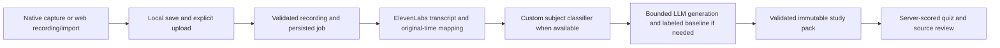

# Alex — Backend, Processing, and AI Integration Specification

Version 0.8 · 2026-11-08 · Project name undecided; “Lecture Companion” is a working descriptor.

**Owner:** Alex, who is the user in this chat. **Status:** initial backend implemented under the user’s explicit local-backend instruction. Source, a pinned environment, terminal launcher and automated backend checks exist; one short real-provider test passed (section 15), followed by offline quality fixes (section 16). The two from-scratch subject/language CNNs and Colab/Jupyter notebook are implemented (section 9); reviewed real-data training and quality evaluation remain pending. Trained-model quality, mobile clients and full endurance remain separate evidence. Section 14 records the current executable subset and limitations. Earlier spec/publication history does not establish a complete product gate.

Companion specifications: [Ben — mobile and web frontend](BEN_FRONTEND_SPEC.md) and [Michelle — interface design](MICHELLE_INTERFACE_DESIGN_SPEC.md). These are the only three active specifications. This file owns shared requirements/defaults, the **canonical API**, model integration, shared delivery gates, open decisions and evidence status. Ben owns functional client behavior; Michelle owns information/interaction design and its handoff. Do not maintain a second API or roadmap elsewhere.

## 1. Sources, authority, and merge decisions

Merged from the three owner specifications at [GitHub commit a2ac616](https://github.com/alexanderchew/group_return_224221_project/commit/a2ac616f2dea13ea8a2e64a71e47f7c61ae7b81a), the local full-product/planning/workstream documents, the Steven/Alex/Ben meeting and attached user context, Alex’s subsequent operating answers, and the current instruction to merge both sets with one contract. The sources are preserved byte-for-byte in the [premerge archive](../planning/archive/lecture-companion-premerge-2026-11-04/MERGE_SOURCES.md). The published specs reference a comprehensive project summary; that separately named original brief was not supplied independently in this merge, so its contents are not asserted beyond the reviewed specs and current meeting.

`C` means direct user constraint or explicit meeting intent. `B` means an engineering default selected for this merged specification, distinct from something said in the meeting. `E` means an optional expansion. A complete specification is not implementation evidence. Latest direct user decisions override conflicting earlier drafts; archived instructions/defaults are historical only.

| Difference between sources | Merged resolution |
| --- | --- |
| Three owner documents versus many local specs/plans | Keep these three canonical owner specs. Fold model/shared contracts/requirements/gates into Alex; retain Ben’s behavior and Michelle’s richer design handoff. Archive superseded drafts. |
| Ten-minute/25-MiB demo envelope versus normal lessons/ten-hour maximum | Alex’s 30–60-minute normal workload and ten-hour maximum control. A short initial fixture is a build sequence, not a replacement limit. The full target remains required and must be measured. |
| Unspecified platform/host/budget | iPhone/iOS **and** Android; current laptop server/data; US$20 combined demo API allowance; terminal key entry; latest stable compatible package policy. |
| `/recordings` versus `/sessions`; seconds versus milliseconds | Retain published `/api/v1/recordings`, `/config` and `StudyPack`; use **seconds at every public media-time boundary**. Retire the local `/sessions` contract. |
| Shared library versus per-install private workspaces | One access-controlled **shared private demo workspace**. All authorized demo clients see the same uploaded library. Unuploaded phone recordings remain local. No personal accounts/private libraries are promised. |
| No model connected versus external baseline | Before custom inference, use an explicitly labeled OpenAI subject baseline bundled with generation, when enabled; otherwise unknown. Do not add a separate paid classification request by default. Preserve custom-model status and fallback provenance. |
| Browser recording deferred versus included | Build web upload first; browser foreground recording remains an explicit full-target feature. Native background/lock behavior is probed early and verified separately. |
| Seven-day automatic expiry versus event cleanup | Keep demo data until explicit deletion/cleanup by Alex; plan cleanup after the event. No automatic seven-day purge. Content-free cost accounting survives study-data cleanup. |
| Heavy model metrics versus minimum credible demonstration | Require reviewed group-separated evaluation, baseline comparison and genuine deployed inference. Keep numerical collection/quality goals as recommendations, not fabricated guarantees or silently approved hard gates. |

The earlier RiftTable game remains removed from active scope; its [historical archive](../planning/archive/rifttable-ar-2026-11-04/ARCHIVE.md) is preserved. The deleted StudySmart notebook is not restored.

## 2. Confirmed scope and selected defaults

The product loop is **record/import → saved audio → ElevenLabs transcript → subject classification → notes and lecture overview → lecture-based questions → backend-scored feedback**. Save transcript before downstream AI. Complete the functional end-to-end loop before custom-model integration. Show which work comes from ElevenLabs, the external LLM and the team’s trained TensorFlow/Keras artifact. Subject classification alone does not prove improved learning.

| Topic | Contract / status |
| --- | --- |
| People | C: Alex backend/integration; Ben mobile/web frontend; Michelle interface design; shared ML work. Name one dataset/training lead and reviewer. Michelle’s design responsibility is retained from the published owner split, including flows and usability, not only colors. |
| Audience | C: IGCSE study rather than Olympiad-specific analysis. Actual board, syllabus/year/tier, subjects and languages need evidence; no syllabus-completeness claim. |
| Mobile and recording | C: iPhone/iOS and Android; most sessions 30–60 min; at most ten hours. B: duration means captured/imported audio, excluding explicit user pauses; store wall-clock intervals separately. |
| Host | C: API, worker, database, original/derived audio, transcripts, packs and models on Alex’s current laptop; phone clients use its trusted LAN/hotspot address. External providers still require outbound internet. No cloud host/public tunnel is needed. |
| Software | B: React Native + TypeScript with Expo development builds for mobile; React + Vite + TypeScript for web; Python/FastAPI, SQLite/private filesystem and one persisted worker for backend. Verify recorder compatibility before committing to a particular audio module. |
| Versions | C intent: latest packages. B interpretation: latest **stable compatible** set resolved at authorized setup, pinned in manifests/lockfiles; honor Expo’s React/React Native set and TensorFlow’s Python compatibility. No prerelease or unattended demo upgrades. |
| API spending | C: US$20 ceiling. B: one combined **total demo allowance**, not per provider/session/month. Reserve conservative cost before every paid request, including retries/chunks. |
| Credentials | C: Alex enters provider keys through a terminal script on the laptop. B: hidden prompt, backend process environment only, no default plaintext persistence. Script is specified, not created here. |
| Access and retention | C: no account login for the demo. B: operator-provisioned demo access, one shared library, explicit deletion and cleanup after the event; no automatic personal sync or automatic expiry. |
| Outputs | C: lecture notes, lecture “meta,” and questions/answer checking. B: meta means subject/description/topics plus evidence-backed objectives/revision priorities when supportable; MCQs first, not free-text grading. |
| Processing | B: batch after explicit Process, not automatic capture/upload or mandatory realtime transcription. Live waveform reflects actual input amplitude. |

### Full requirements and ownership

These IDs preserve the local requirements so none disappear during consolidation. Delivery grouping is defined in section 11.

| ID | Requirement / status | Owner / gate |
| --- | --- | --- |
| LC-01 | C: active study app; previous game/notebook stay inactive | Alex / documentation |
| LC-02 | C: native Start/Pause/Resume/Stop, real waveform, elapsed audio | Ben / G2, G5 |
| LC-03 | C: web file picker/drag-drop; browser recording retained full target | Ben / G1 upload, G5 recording |
| LC-04 | C: durable multi-session library, date/duration, playback and deletion | Ben/Alex / G2, G4 |
| LC-05 | C: ElevenLabs and saved source-linked transcript | Alex / G1 |
| LC-06 | C: lecture-grounded structured notes | Alex/Ben / G1, G4 |
| LC-07 | C term/B shape: lecture overview separate from notes/performance | Alex/Michelle / G1, G4 |
| LC-08 | C: questions, answers, correctness and explanations | Alex/Ben / G1, G4 |
| LC-09 | C: genuine TensorFlow/Keras subject classifier | ML lead/Alex / G3 |
| LC-10 | C: functional end-to-end baseline before custom integration | Alex/Ben / G1 → G3 |
| LC-11 | C no login/B shared controlled workspace | Alex / G0, G4 |
| LC-12 | C: owner handoffs and intact functional UI through redesign | All / G0–G6 |
| LC-13 | C: iPhone/iOS + Android, with web interface | Ben / G2, G5 |
| LC-14 | C: IGCSE focus, coherent subject labels | ML lead / G0, G3 |
| LC-15 | C: normal 30–60 minutes; ten-hour maximum | Ben/Alex / G4 normal, G5 maximum |
| LC-16 | C consideration/B optional derived denoise/silence transforms | Alex / G5 only if enabled |
| LC-17 | C latest packages/B compatible pinned merged stack | Alex/Ben / G0 |
| LC-18 | B: durable checkpoints, resumable upload, persistent stages/partial results | Alex/Ben / G2, G4, G5 |
| LC-19 | B: evidence references, transcript revisions, immutable packs/attempts | Alex/Ben / G1 baseline, G4 revisions |
| LC-20 | B: own-model/baseline/unknown/saved-example provenance | All / G1–G6 |
| LC-21 | C host/budget/key entry; B operating/access/deletion controls | Alex / G0, G4 |
| LC-22 | B: reproducible held-out ML and measured device/endurance evidence | ML lead/QA / G3, G5 |
| LC-23 | C: real demonstration and explainable contributions | All / G6 |
| LC-24 | E: trained dialogue/topic/concept/question-selection models | Separate scope/evaluation |
| LC-25 | E: accounts, payments, public hosting, dashboards, adaptive mastery/LMS | Separate scope |
| LC-26 | E: verified board/year/tier-specific syllabus mapping | Supplied sources and separate validation |

## 3. Architecture and operating envelope

API requests validate/authenticate and persist work; the worker handles media, model/provider calls and stage checkpoints independently of a screen/request lifetime. Keep provider schemas behind adapters. SQLite plus atomic file writes/private directories is the selected one-laptop baseline; one worker claims jobs transactionally. Initially execute one pipeline at a time to keep memory and shared budget predictable. Do not infer multi-host capacity or queue-platform readiness.



| Configuration | Merged value / interpretation |
| --- | --- |
| Target duration | `target_max_duration_seconds: 36000`; ordinary workload 1,800–3,600 seconds; explicit pauses excluded. `/config.max_duration_seconds` reports the currently verified processing envelope until full-target evidence passes. |
| Target bytes | B: `target_max_audio_bytes: 2000000000` aggregate original bytes; independent of duration. `/config.max_audio_bytes` reports the verified active intake limit. Large PCM/WAV can exceed the full byte target before ten hours. |
| Capture format | Target compressed mono around 64 kbit/s where supported; negotiate/probe actual format; about 288 MB per ten hours before copies/overhead at that bitrate |
| Formats | Prove MP3, M4A/AAC and WAV; add browser WebM/Opus or alternate format only after platform/backend/provider decoding works; `/config` advertises verified formats |
| Checkpoints / chunks | B targets: durable capture about every 10 s; transport parts 8 MiB; decodable provider chunks about 600 s with up to 2 s context overlap. They are different boundaries. |
| Quiz | Target five MCQs, four distinct options, one correct; fewer if source supports fewer; no invented padding |
| Retries / polling | At most three attempts **including the initial call** for a configured provider operation; jitter/backoff/Retry-After. Poll about 2 s while visible, back off offline/idle. |
| Budget defaults | Ceiling US$20; warning US$16; retain proposed US$2 contingency; conservative persisted reservations before paid work |
| Local/server retention | Until explicit scoped deletion/cleanup; Alex plans post-event cleanup. No automatic purge or allowance reset. |
| Interaction goals | B: UI response p95 <200 ms; metadata API p95 <500 ms excluding uploads/providers. Aim ≤3 min for a 2-min D0 sample, measured rather than promised. |
| Crash loss | B goal: ≤10 s lost after abrupt capture termination, dependent on verified native capability; never claim it before a measured run |

Exact package/model versions, bounded provider prices, disk reserve, device/OS/browser inventory and usable throughput are recorded at G0, not invented in this spec. No paid feature is enabled with an unknown price/bound. A short demo does not establish these full capacity targets. If an early build accepts a smaller tested envelope, expose `capacity_status: prototype_limited` and show both active limits and the full target; do not silently redefine the product maximum or label untested ten-hour capacity verified.

## 4. Canonical API — conventions and access

This and section 5 are the **only** public API/data definition. Ben and Michelle link here instead of maintaining another schema. Alex generates OpenAPI from the backend implementation using `scripts/export_contract.py`; the generated contract is under `fixtures/contracts/`. API prefix `/api/v1`; study-pack schema `1.0` is implemented for the initial backend subset recorded in section 14.

- JSON uses `snake_case`, opaque string IDs, UTC ISO-8601 event timestamps and **seconds** for all media durations/offsets (`duration_seconds`, `start_seconds`, `end_seconds`). Seconds are finite nonnegative numbers, fractional when necessary. Internal sample counts/milliseconds are converted at the adapter boundary; no public `*_ms` or `/sessions` alternative.
- Unavailable ASR timing is `null` for both start/end. Do not invent word-level confidence/speaker identities. Valid timed spans have start ≤ end in original-audio coordinates.
- One shared demo workspace: every authorized client sees all uploaded recordings. There is no per-user owner field supplied by clients and no private-library claim. Unauthenticated/invalid demo access is denied even if an ID is guessed. Provision connection access through operator setup: native uses a revocable app-access bearer credential; web uses a secure HttpOnly cookie with CSRF protection. These access credentials are distinct from provider keys. Provisioning is outside normal student flows, without accounts or a public pairing service.
- Provider keys are never accepted by client-facing routes. CORS is not authentication. Use a trusted HTTPS/localhost setup as appropriate; phone clients use the laptop’s reachable LAN address, not phone localhost. Restrict host interfaces/origins to the demonstration network.
- Upload, job creation/retry/regeneration, revision/override creation, quiz submission and solution reveal require `Idempotency-Key`, scoped to the stable demo workspace+route+operation key, with a stored body digest; credential rotation must not create a new idempotency namespace. Reuse on transport retry; new key for intentional new work. Same key/body returns the original outcome; different content returns `409 idempotency_conflict`. Keep keys for the supported retry horizon. Authenticate and check deletion/tombstones before replaying a cached response; deleting content revokes/purges cached sensitive responses too. This is not an exactly-once vendor-billing guarantee.
- List/large transcript routes use cursor pagination: `{items, next_cursor}` or `{segments, next_cursor}`. Resource edits use `If-Match`/expected revision; conflicts do not overwrite newer data. Media bytes stay out of JSON/database rows.
- Immutable transcript, study-pack and model versions retain their provenance. Incompatible schema/label changes require a version/migration decision. Safe examples below are fixtures, not real IDs/data.

### Canonical resources

| Resource | Required fields / invariant |
| --- | --- |
| `Recording` | `id`, `title`, `source` (`mobile` or `web`), `recorded_at` nullable, `created_at`, `duration_seconds`, `byte_size`, `mime_type`, `latest_job_id` nullable, `current_transcript_revision_id` nullable, resource `revision`, deletion state |
| `Upload` | `id`, source/title/date, files/part manifest, expected and verified sizes/digests, state/expiry, resulting `recording_id` nullable; one-shot and resumable intake produce the same Recording |
| `AudioAsset` / `MediaTransform` | Original/derived asset, digest, verified sample/duration/channel metadata; derived→original span map and operation/version; no public filesystem path |
| `TranscriptRevision` | `id`, recording/source asset, parent revision, provider/model/config, origin provider/user-corrected, `segments`, `next_cursor`, original coverage/gaps and created time |
| `TranscriptSegment` | `id`, `text`, nullable `start_seconds`/`end_seconds`, optional anonymous speaker label and chunk provenance; IDs stable within immutable revision |
| `Job` | `id`, `recording_id`, input revision/config, `retry_of_job_id` nullable, `status`, `stage`, `updated_at`, per-stage attempts, `study_pack_id` nullable, safe `error` nullable |
| `StudyPack` | `schema_version`, `id`, `recording_id`, `transcript_revision_id`, `created_at`, `output_language`, paged `transcript_segments` and `transcript_next_cursor`, `classification`, nullable `subject_override`, `metadata`, `notes`, `quiz_status`, public `questions`, `artifact_statuses`, coverage/gaps, computed `freshness` current/outdated and warnings |
| `Classification` | `label` nullable, `source` (`custom_model`, `openai_baseline`, `unknown`), `model_version` nullable, `score` nullable, `fallback_reason` nullable, `custom_status` and nullable `custom_prediction` (section 10). Baseline/unknown score is null; selected result never disguises its source. |
| `SubjectOverride` | Human-selected subject, input revision, created time/reason and linked raw prediction. Never rewrites model results or automatically becomes training data. |
| `Metadata` | `title`, `description`, description `evidence_segment_ids`, topics as `{text,evidence_segment_ids}`; optional evidence-linked inferred objectives/prerequisites/revision priorities; declared board/year/tier separate and nullable |
| `Notes` | Array of sections `{heading, points:[{text,evidence_segment_ids}]}`; optional source-supported definitions/formulas/examples within points. Generated background, if allowed, is clearly distinguished from lecture claims. |
| Public `Question` | `id`, `prompt`, four `options:[{id,text}]`, `evidence_segment_ids`; omits answer key/explanation before submission/reveal |
| Private answer key | Pack/question ID, correct option ID, explanation, supporting segment IDs; server only until submit/explicit reveal |
| `QuizAttempt` | `id`, `study_pack_id`, `correct_count`, `total_count`, `unanswered_count`, one-decimal `percentage`, `practice_revealed`, submitted time and per-question results |
| `DemoBudget` / `UsageReservation` | Ceiling/settled/reserved/uncertain/contingency/available amounts in USD decimal strings or exact integer micro-units internally, request/provider/job correlation, price version and status; durable independently of study-data retention |

`freshness` compares the captured transcript plus generation settings/subject-override version to the current recording, without rewriting immutable generated content. Capture model/prompt/config/override provenance with each job/pack; changing the selected override/config can make prior output outdated just as a transcript edit does. A long pack embeds only an initial transcript page; clients fetch further/source segments via the transcript route and must not assume the embedded page covers the whole recording. All evidence refers to the pack’s exact transcript revision; validate segment existence, optional quoted spans and coverage. Existing IDs alone do not establish that a claim is supported; human-review representative content.

## 5. Canonical API — endpoints, jobs, errors, and scoring

Paths below are relative to `/api/v1`. All resource routes use configured demo access. Ordinary creates return 201, accepted jobs 202, reads 200. The versioned contract includes extensions from the start; some F1 routes may return a documented `feature_unavailable` before their gate, and `/config` advertises enabled features. There is no competing D0 schema.

| Method / path | Request and behavior | Delivery |
| --- | --- | --- |
| `GET /config` | Verified active `max_audio_bytes`/`max_duration_seconds`, `target_max_audio_bytes`/`target_max_duration_seconds`, `capacity_status` (`prototype_limited` or `full_target_verified`), accepted verified MIME types, `output_languages`, `default_output_language`, `workspace_mode: shared_demo`, enabled features/classifier modes, provider-configured booleans, API/build/locked dependency versions; no secrets | D0 |
| `GET /budget` | Safe total/settled/reserved/uncertain/contingency/available budget; cannot increase/reset allowance or reveal lesson data | D0 |
| `POST /recordings` | Multipart `file`, `source`; optional title/date. Validate and persist finalized original; return Recording. No paid work. | D0 |
| `GET /recordings` | Shared demo library, paginated newest first, optional search/state filters | D0 |
| `GET /recordings/{recording_id}` | Recording state/current revision/job summary; 404 when absent/deleted | D0 |
| `PATCH /recordings/{recording_id}` | Title/declared metadata with expected resource revision; never rewrites classifier history | F1 |
| `DELETE /recordings/{recording_id}` | Tombstone first; delete app-managed source/derived media, transcripts/packs/keys/attempts/jobs; discard late writes. Repeated delete 204; pending cleanup may return 202 with safe status. | D0 |
| `POST /recordings/{recording_id}/jobs` | Empty object for initial processing; optional `retry_of_job_id`, `transcript_revision_id`, `regenerate` for explicit recovery/revision work. Return persisted Job; rules below. | D0; revisions F1 |
| `GET /jobs/{job_id}` | Job body includes failed/partial/blocked state even with HTTP 200 | D0 |
| `POST /jobs/{job_id}/cancel` | Prevent future stages; best-effort vendor cancel only if supported; cannot guarantee a refund | F1 |
| `GET /recordings/{recording_id}/study-pack` | Latest valid pack (including clearly marked partial/outdated content); 409 `not_ready` if none available | D0 |
| `GET /study-packs/{study_pack_id}` | Frozen pack by ID, including historical version needed for review | D0 |
| `POST /recordings/{recording_id}/quiz-attempts` | Exact `study_pack_id`, each question once with option/null; backend grades and returns immutable QuizAttempt | D0 |
| `GET /quiz-attempts/{attempt_id}` | Reopen submitted result/key/explanations under demo access | D0 |
| `GET /recordings/{recording_id}/transcripts/{revision_id}` | Immutable revision metadata and paged segments; optional `segment_ids` lookup instead of cursor to resolve references | D0 |
| `POST /recordings/{recording_id}/transcript-revisions` | Base revision and text edits; create immutable revision with optimistic concurrency, mark packs outdated | F1 |
| `POST /recordings/{recording_id}/subject-overrides` | Selected subject/reason/input revision; keep raw classification | F1 |
| `GET /recordings/{recording_id}/audio` | Authorized original audio delivery with byte ranges or short-lived scoped access; source seeking follows original seconds | D0 playback; F1 seeking |
| `POST /study-packs/{study_pack_id}/quiz-solutions` | Explicit reveal, persist revealed-practice history; never counts as an unseen quiz attempt | F1 |
| `POST /uploads` | Source/title/date plus ordered file/capture manifest: per-file IDs, MIME, bytes, SHA-256, source/capture offsets and gap metadata. Create resumable transport upload. | F1 |
| `GET /uploads/{upload_id}` | Verified received files/parts/digests and expiry for resume | F1 |
| `PUT /uploads/{upload_id}/files/{file_id}/parts/{part_index}` | Bounded binary part + checksum; matching repeat safe, mismatched digest conflicts | F1 |
| `POST /uploads/{upload_id}/complete` | Verify every file/manifest, decode/reconstruct logical audio, register one Recording and return it; no paid call | F1 |

Local UUID→server Recording associations are persisted once. A capture can contain rotated files/fragments; the manifest preserves order/container context and pause/interruption gaps. Upload transport parts are not assumed independently decodable media. File and aggregate limits are rechecked server-side; incomplete/corrupt uploads do not become a successful recording.

### Job state and retry rules

The single job-status enum is `queued`, `preparing_audio`, `transcribing`, `analysing`, `generating`, `validating`, `ready`, `partial`, `blocked`, `failed`, `canceled`. `stage` identifies the exact checkpoint: `validate_media`, `prepare_audio`, `transcribe`, `classify_subject`, `generate_notes`, `generate_overview`, `generate_quiz`, `validate_outputs`. Capture/upload states remain client/transfer state, not invented job statuses.

One active job per recording. Matching repeated requests return that active job; a different requested input/config while active returns 409. A ready recording reopens its pack unless `regenerate: true` explicitly requests a new version. A failed/blocked/partial job retry uses a new idempotency key/job ID with `retry_of_job_id`, reusing compatible completed stages and preserving prior attempts. If its outcome is ambiguous, reconcile the provider request/reservation before another paid submission. On worker restart, recover checkpoints, mark interrupted stages accurately and wait for explicit safe retry; no automatic duplicate paid work.

Artifact outcomes are `ready`, `failed`, `unavailable` or `insufficient_evidence`. Public `quiz_status` is `available`, `insufficient_evidence`, `failed` or `unavailable`; only `available` carries answerable questions. Publish a validated pack only at a requested run’s complete or explicitly partial outcome; any later improvement creates a new immutable pack ID, not an in-place partial-to-ready rewrite. `ready` means requested educational outputs have valid complete coverage; disconnected/unknown custom inference does not block the permitted D0 baseline or establish ML completion. Notes/overview without a defensible quiz, or explicitly restricted available coverage, produce `partial`, not a full assessment pass. A transcript-only successful checkpoint remains accessible after downstream failure. No usable teaching content fails honestly. Budget blocks preserve results/media and return `blocked`; never erase work to free accounting.

### Error envelope

```json
{
  "error": {
    "code": "transcription_unavailable",
    "message": "Transcription could not finish. Your recording is saved.",
    "retryable": true,
    "stage": "transcribe"
  },
  "request_id": "request_example"
}
```

`Job.error` contains just the inner error object; job/request correlation is recorded separately. Non-job errors have `stage: null`. Normalize framework errors into this shape. Representative codes: `unsupported_media`, `media_corrupt`, `size_limit`, `duration_limit`, `storage_limit`, `checksum_mismatch`, `upload_incomplete`, `no_usable_speech`, `provider_unavailable`, `provider_submission_unknown`, `invalid_generated_output`, `budget_exceeded`, `price_configuration_required`, `revision_conflict`, `study_pack_outdated`, `idempotency_conflict`, `feature_unavailable`, `processing_interrupted`, `deleted`.

Use 401/403 for absent/invalid access as appropriate without leaking resources; 404 missing/deleted; 409 state/version/idempotency conflicts; 413 oversized bytes; 415 unsupported media; 422 invalid media duration/content/answers; 429 configured usage/rate limits; 503 temporary dependency failure. A failed job read can be HTTP 200: clients inspect `status`. A safe error never contains keys/private raw logs.

### Authoritative quiz scoring

```json
{
  "study_pack_id": "pack_example",
  "answers": [
    {"question_id": "q_1", "option_id": "option_b"},
    {"question_id": "q_2", "option_id": null}
  ]
}
```

Every public question appears exactly once; null means unanswered. Outdated packs remain readable and old submitted attempts retain their evidence, but a new submission against an outdated pack returns 409 `study_pack_outdated`; direct the user to current material. Reject duplicate/unknown questions, invalid options, foreign recording/pack, changed version and client-supplied score/key. Correct answers score one; incorrect/unanswered score zero; no negative marking. Return percentage `100 × correct_count / total_count`, rounded to one decimal. An available quiz has ≥1 question; zero valid questions yields `quiz_status: insufficient_evidence`, empty questions and no score, never division by zero. Return per-question selected/correct option, correctness, explanation and evidence. Resubmitting the same operation is idempotent; an intentional retake gets a new attempt and preserves the old one. After solutions were submitted/revealed on that pack, later practice is flagged `practice_revealed`; never present it as an unseen mastery test.

## 6. Media capture, long sessions, and processing recovery

Ben owns native capture; Alex validates actual media content/decoded sample duration and preserves originals before acknowledging storage. Keep memory/disk bounded, reserve working space, use generated paths and atomic writes, and avoid shell interpolation/unrestricted URL fetches. File extensions/client MIME/clock callbacks are not authoritative. At the cap, native recording finalizes safely; oversized imports are rejected with conversion guidance, not silently truncated.

Ten hours is a whole workflow workload, not one in-memory blob, HTTP request or LLM prompt. Use capture checkpoints to protect media, transport parts for resumable bytes, and separately decodable provider chunks. Native background/lock, calls, input changes, OS termination, low storage/battery and restart are probed on both phones early. A recorder finalizing only on Stop may not meet the loss goal; select/prove a suitable adapter or scoped native module. No guarantee is inferred from Expo support.

Browser recording is foreground-only in the selected baseline. MediaRecorder events can be delayed by suspension; persist fragments with container initialization and decode them coherently. Do not count callbacks as duration or pretend arbitrary blobs are standalone files. Detect stopped tracks/interruption where possible, preserve available data and mark gaps. Desktop web uses a secure origin; native ten-hour background reliability is a separate claim.

Working chunks retain source offsets; overlap supplies context, while disjoint owned intervals govern merging so repeated words are not duplicated. Convert ASR-relative times through any transform map into original-audio seconds. Chunk speaker labels remain anonymous/unlinked unless a tested method establishes identity. Missing chunks create visible incomplete coverage; do not infer missing teaching. Expose retry for the failed chunk/stage while retaining successful text.

Denoising and silence trimming are distinct optional transforms, off initially. Keep original bytes; first use VAD for navigation, compare mild denoise against original recognition and retain speech padding. If trimming is enabled, persist piecewise derived→original maps so note/question jumps still play the correct original moment. No speech produces no fabricated lecture.

## 7. Generation, revisions, and educational quality

ElevenLabs handles transcription; the team classifier predicts subject from transcript; the LLM initially generates notes/overview/questions. Choose actual supported provider/model configurations within budget and record them; “ChatGPT” means API integration, not automating a consumer chat session. Do not claim external ASR/generation was trained by the team.

Version provider/model/prompt/schema/config/input digest and coverage. Treat the transcript as untrusted evidence, not executable instructions; no unrelated tools/web retrieval are needed. Subject is an organizational hint, never a source for untaught concepts. Notes include supported explanations, definitions, equations/units/examples and uncertainties rather than confidently repairing an unknown formula. “Meta” separates content overview from file metadata and quiz performance; it cannot infer attention, intelligence, emotion or long-term mastery from audio.

For long inputs, count bounded context/output, map sections into source-linked extracts, then merge/deduplicate with retained source IDs. Checkpoints preserve later sections and gaps; never send the whole transcript on an assumption it fits or silently truncate it. Default short generation may combine notes/overview/quiz and external subject baseline in one schema-constrained call. F1 can use bounded staged calls; every call reserves budget. Refusal, incomplete output and invalid evidence are explicit failures with bounded repair, not empty success.

Validate shape, option/key membership, unique options/question IDs and source-reference existence before publication; review actual support/factual correctness on representative subjects/languages. Schema validity is not educational correctness. Target five MCQs; accept fewer supported items, not hallucinated padding. Free-text marking needs a separate adopted rubric/evaluation.

At initial pack publication, randomly permute the four possible correct-answer positions without repetition for the first four questions; a fifth may reuse one position. Shuffle distractors and relabel options `a`–`d` in display order while mapping the correct content to its new private key. Freeze that layout/key with the pack. The options array defines display order; IDs in historical packs remain valid as originally published. Options/explanations must describe content without relying on letters or positions. This local rule uses no provider call.

Keep source IDs in structured `evidence_segment_ids`, rather than overview title/description/topic prose. The prompt states this explicitly; local publication also strips inline ID citations without discarding structured references or ordinary formulas/brackets. Citation-only text fails validation instead of becoming an empty overview. Raw generation checkpoints retain the provider's original output. Prompt changes use one version constant in provider provenance and generation cache keys; local output processing has its own provenance version.

Save provider original text; text corrections create immutable TranscriptRevision, never overwrite it. New generation produces a new StudyPack bound to that revision. Old packs become visibly outdated; old attempts retain original wording/key/source. Jobs finish against their captured revision and cannot silently attach old results to new text. Manual subject overrides remain separate; no automatic retraining from corrections.

## 8. Budget, terminal credentials, storage, and deletion

### Shared US$20 controller

One persistent laptop ledger covers all paid API providers, clients, jobs, chunks and retries. Use exact decimal/integer accounting. Before a request, atomically require:

`settled_spend + outstanding_or_uncertain_reservations + conservative_next_request_bound + contingency <= 20 USD`

Warn at US$16 and retain proposed US$2 contingency. Reserve transcription’s billed duration/overlap/rounding and any enabled add-ons, and bounded LLM input/output/reasoning-token costs per actual pricing rules. Unknown/unbounded prices or usage block submission. Reconcile actual usage; do not release ambiguous reservations because a client timed out. Account/provider alerts/limits supplement rather than replace the combined controller. Actual account fees/taxes/billing delays may differ from estimates: reconcile and halt instead of claiming a perfectly guaranteed vendor charge cap.

The ledger survives restarts, credential changes, month boundaries and deletion/cleanup of study data. It contains minimal content-free accounting and cannot be reset/increased by phone/web routes. Only Alex deliberately changes allowance. No automatic subscription/top-up/minimum purchase; check any agreed new fee against the same allowance. Budget block preserves recording/transcript and permits local inference/capture/cached review. Test reservation races/unknown cost/restart/deletion using synthetic charges, not US$20 of test spending. A ten-hour local endurance capture need not be paid-transcribed.

### Terminal launcher contract

The implemented entry point is `scripts/start_demo.py`, also available through `scripts/start_demo.command`. On future authorized setup it loads non-secret host/storage/pinned versions and existing budget state, then prompts Alex with no echo (for example `getpass`) for `ELEVENLABS_API_KEY` and `OPENAI_API_KEY` if OpenAI is selected. Existing deliberately supplied backend environment may be supported without printing values.

Do not put keys in command arguments, chat/browser/mobile input, source, logs, client bundles, crash dumps or default plaintext `.env` files. Inject them only into API/worker process environments, launch children without shell interpolation/tracing, and avoid billable key checks at startup. Missing keys disable their paid stages with clear status; EOF/interrupt exits cleanly. Show only configured booleans and safe LAN/localhost/budget status. Provision app connection access separately from provider keys. Stop services cleanly, retain media/jobs/ledger and remove transient references where practical without promising memory erasure. Restart does not reset spend or update dependencies.

### Shared demo privacy and lifecycle

All authorized demo devices may view/delete uploaded content; explain this before transfer and use approved recordings. Audio goes to ElevenLabs and transcript content to the LLM as configured; local hosting does not imply provider processing is offline. Recording consent and training reuse are separate; no automatic training intake from user uploads. Exact school/contest policies remain to verify.

Alex retains demo server data until explicit deletion and plans cleanup after the event. Phone-local deletion and server deletion are separate actions; web deletion cannot remove the original input file from a computer. Tombstone before cleanup and check it before worker/callback writes; late provider responses cannot resurrect data. Remove original/derived files, manifests, transcripts/packs/keys/attempts and applicable caches. Retain only content-free accounting needed to prevent budget reset; disclose user exports/provider copies outside app control. No promise of provider zero retention/deletion without actual account verification. Do not expose a public unauthenticated paid proxy.

## 9. Model training, evaluation, and deployment

Alex owns serving integration; name the dataset/training lead and independent reviewer before collection. The first team-trained task is transcript content→academic subject using TensorFlow/Keras. A Chemistry lecture spoken in English is not an English class. Freeze a coherent label set without mixing generic Science with unqualified subject subclasses. IGCSE board/year/tier/topic alignment needs real supplied sources; topic/dialogue/question-selection models are optional later work with their own data/evaluation.

Maintain independent lecture/source-family IDs, permission, subject label, language/code-switching, speaker pseudonym where appropriate, spans, reviewer/disagreement and provenance. Keep private audio/text outside Git. Source count means independent lessons, not arbitrarily multiplied overlapping windows. Include realistic ASR noise, not only clean textbook paragraphs; label synthetic/LLM-assisted data and human-review the held-out real set.

Split original source groups **before** windowing. Excerpts/re-recordings/processed variants/translations/paraphrases from one source stay together. Proposed starting train/validation/test ratio is 70/15/15 where independent groups/class coverage permit; hold out speakers/teachers/conditions when feasible. Fit vocabulary/preprocessing only on training; tune architecture/stopping/calibration/thresholds only on validation; freeze before final untouched test. Audit duplicate leakage and exclude filenames/declared subject hints from predictive input.

Alex's 8 November attachment and direct implementation instruction select **two separate character CNNs trained from scratch** in TensorFlow/Keras: subject recognition and multi-label language recognition. Use standard Keras character vectorization, randomly initialized Embedding, Conv1D, global max pooling, Dense and task-specific outputs. Do not use pretrained embeddings, BERT/XLM-R/fastText or an external LLM as either final classifier. This supersedes the earlier optional pretrained-representation suggestion for this implementation. Compare majority/prevalence and useful simple baselines on the same groups. Window/aggregate the whole transcript without double-counting overlap and abstain on insufficient/mixed/uncertain material. Thresholds are limited uncertainty rules, not proof of universal unknown detection.

The subject dataset records reviewed activity roles (`instruction`, `supporting_example`, `administration`, `unrelated`); initially train only instructional sections. Never infer a Physics training label merely because a public-speaking lesson uses conservation of energy as an example. The language dataset records per-section language presence using independent binary labels, including code-switching. Do not copy all of a lecture's languages onto each section. Use original-language transcripts: translated text cannot establish original spoken language. A written Chinese tag does not distinguish Mandarin/Cantonese or measure speaking time. Activity classification and hierarchical context models remain optional later experiments, not implemented capability.

Required report: independent groups/class/split, windows, imbalance, accuracy, macro/weighted F1, per-class precision/recall, confusion matrix, coverage/selective precision, known-input abstentions as misses, out-of-scope false acceptance, language/speaker slices where possible, inference timing and representative errors. Confidence is not automatically calibrated probability. A separate corrected-text diagnostic can distinguish ASR from classifier errors. Report small-sample uncertainty and failed targets honestly.

Minimum model checkpoint: credible reviewed group-separated evaluation, outperform the recorded majority baseline on macro F1, inspect every supported class, serving/reload parity and a genuine independent-recording inference feeding the app. Numerical **recommended goals**, not hard promises: collect about 20 independent groups/subject for 3–5 data-supported subjects, aim macro-F1 ≥0.80, selective precision ≥0.90 at coverage ≥0.70 and out-of-scope false acceptance ≤0.10. Insufficient data means explicitly preliminary claims or reduced adopted taxonomy, never misleading chunk-level accuracy.

Deliver the actual bundle: model, vectorizer/preprocessing, labels/order, window/aggregation policy, thresholds, data/split hashes, seed/config/code/environment versions, training command/history, metrics/model card and parity fixtures. Use latest stable TensorFlow/Keras compatible with the laptop/Python runtime, then pin. Load once server-side; mobile/web need no TensorFlow package. Verify shape, label order and finite scores; retain a known validated bundle for rollback and freeze the chosen bundle per job.

### From-scratch implementation checkpoint — 8 November 2026

`training/` contains the two CNNs, a Colab/Jupyter notebook, annotation templates/draft preparation, strict data validation, training/evaluation, safe reload and local prediction. The isolated ignored environment is `var/training-env/`; TensorFlow 2.21.0, Keras 3.15.1 and their compatible dependencies are pinned with hashes in `training/requirements.txt`. The API environment, provider configuration, live study library and budget are unchanged. Alex explicitly authorized publishing the training source, notebook and related documentation to GitHub on 8 November. Raw transcripts, generated models and executed private notebooks stay ignored under `var/`. This source publication does not deploy a model or authorize a paid provider request or cloud build.

Chosen defaults: original Unicode character input, Keras lowercase with technical punctuation retained; max vocabulary 8000; Embedding 64 → Conv1D 128/kernel 5 → global max pooling → Dense 64 → Dropout 0.25. Subject output is softmax/sparse categorical cross-entropy; languages use independent sigmoid/binary cross-entropy and a separately learned vocabulary/weights. Subject sections are at most 1000 characters to match the current server; language sections are at most 240 characters. Overlong annotations are rejected for human segmentation/review, not silently truncated. Source-family loss weighting prevents derivatives or many sections from multiplying one source's contribution.

CSV imports support `lecture_id` and optional `source_family_id` (defaults to lecture ID; explicitly group known derivatives), with preassigned train/val/test splits. Validation rejects split leakage, duplicate text across splits, inconsistent source mapping, missing labels, unsupported roles, unseen held-out subjects and language labels lacking positive/negative coverage. Vocabulary fits training text only; validation selects stopping/thresholds; the frozen test set supplies final section metrics. The trainer exports full history, baseline comparison, per-class/F1/confusion and mixed-language metrics, split/source/model hashes, seed/environment/configuration and a code snapshot. Human annotation truth cannot be certified by structural checks.

Alex clarified that the real transcript folder will be created later. Header-only CSVs and an empty transcript directory are prepared under `var/training-data/`; there is **no supplied reviewed multi-subject training dataset yet**. Both CNNs have run only on marked synthetic software-check examples, with actual parameter updates and save/reload parity; a private smoke-mode notebook also executed both default networks successfully, including export and local prediction. Fifteen automated training tests pass with external connections blocked. This is executable pipeline evidence, not trained-on-own-lectures evidence or a G3 pass. Numerical synthetic scores are not subject/language quality claims. Real-data training and independent evaluation remain pending annotation.

Synthetic exports use `synthetic_smoke_unicode_text_v1`, which the production subject loader rejects. Real subject experiments use the existing `unicode_text_v1` bundle interface; local language experiments use `unicode_language_text_v1` and are not wired into the public subject API. Every export remains marked `production_eligible: false` for human review; no pointer to the live worker is changed. Training outputs live under ignored `var/models/`. The existing public API/Classification schema remains unchanged; integrating language predictions requires a later coordinated canonical-contract update here, not a competing API specification.

## 10. Classifier and fallback contract

Internal adapter: `classify(transcript_text, transcript_revision_id) → custom prediction` with label/scores/model/preprocessing/label version, accepted/abstained/failed/unavailable status, reason and covered windows. Its raw prediction is preserved before any override/fallback.

Public `Classification.custom_status` is `not_run`, `unavailable`, `accepted`, `abstained` or `failed`. `custom_prediction` retains raw model output/status/version when it exists. Select `source: custom_model` only for accepted real inference; baseline and unknown carry null `score` and no fabricated custom model version. If custom inference is missing/uncertain, an enabled bounded generation request may return a labeled `openai_baseline` subject; otherwise return `unknown`. No separate paid classification call is made by default. Non-null `fallback_reason` explains why the external/unknown selection was used. A manual `subject_override` never changes any of these fields.

```json
{
  "label": null,
  "source": "unknown",
  "model_version": null,
  "score": null,
  "fallback_reason": "custom_model_not_connected",
  "custom_status": "unavailable",
  "custom_prediction": null
}
```

An external baseline is not team-trained output; unknown/missing mode is not a passing ML gate. D0 may run honestly before the model exists. F1 requires real custom inference/evidence; failure may leave the functional baseline usable but must not be reported as validated custom AI. Subject hints/overrides cannot authorize generation of unrelated lesson content or establish lower cost/latency without measurement.

## 11. Shared delivery gates and acceptance

D0 is a short real end-to-end demonstration completed across web and both native clients by G1 + G2, not full capacity. G1 alone proves the web baseline, not both phones. F1 is the complete adopted target including both native platforms, normal sessions, genuine model evidence, browser recording, recovery/revisions and maximum duration. Features are sequenced, not silently removed. Backend work has started and automated/local-runtime evidence is recorded in section 14. No complete G0–G6 cross-client/provider/model gate is claimed passed; missing device, account, dataset and teacher-rule evidence remains explicit.

| Gate | Dependencies | Outcome and acceptance evidence |
| --- | --- | --- |
| G0 — Contract and feasibility | Explicit implementation instruction; relevant open facts | Freeze this API/fixtures, inventory laptop/phone/OS/browser/LAN and compatible pinned tools, confirm provider/account prices/rubric, source location and ML lead. Early native recording/background probe on both phones; no ten-hour claim. |
| G1 — Real web D0 | G0 | Short authorized file→real upload/ElevenLabs→saved transcript→notes/overview/quiz→server feedback; safe credentials/budget/idempotency and honest baseline. No fake provider result. |
| G2 — Native integration | G0; final flow G1 | Both actual iPhone and Android start/pause/resume/stop/save/waveform, persistent library/playback, upload to laptop, same study/quiz contract; denied permission/offline/relaunch/delete checks. |
| G3 — Real custom model | Dataset branch can start after G0; integration acceptance after G1 + G2 | Source-group dataset/evaluation/baselines/frozen bundle, reload/serving parity and genuine inference; accepted/abstained/failure/baseline UI. Dataset work can run alongside G1/G2. |
| G4 — Normal lessons, integrity and design | Acceptance after G1 + G2 + G3; design/recovery work can start earlier | Full 30-min and 60-min native recordings on both phones, resumable upload/checkpoint recovery, transcript revision/stale-pack/frozen-attempt tests, human grounding/quiz review, Michelle’s implemented design, access/deletion/budget lifecycle checks. |
| G5 — Full duration and browser capture | G4 | Foreground browser capture, long transcript paging/chunking/coverage and source seeking; real-time ten-hour native capture on both phones, near/over-limit import/recovery/disk/battery/interrupt checks. Test local endurance without automatic paid transcription; enabled media transforms preserve original times. |
| G6 — Rehearsed F1 handoff | G3 + G4 + G5 | Reproducible builds and actual device/network runs, timed live and labeled saved workflows, provenance/model/data/prompt versions, measured timing/cost and remaining limits, teacher/rubric check and contribution explanations. |

Michelle starts flow/wireframe/token work early and reviews functional screens as they exist; redesign preserves behavior. Alex/Ben integrate one real endpoint early. No event date or team effort estimate is inferred; if only D0 is deliverable, report the missing F1 evidence instead of claiming the full ten-hour/native/ML scope complete.

### Acceptance checks and evidence status

- [ ] Valid media persists; unsupported/corrupt/empty/over-limit media fails before paid work; durations/codecs match decoded evidence.
- [ ] Idempotent upload/jobs/attempts, safe restart/retry/unknown-charge handling and deletion-in-flight prevent duplicate logical work/resurrection.
- [ ] Notes/overview/questions have real lesson support; invalid references/ambiguous keys are rejected; partial/no-quiz output is labeled correctly.
- [ ] Scoring handles correct/incorrect/unanswered/duplicate/invalid/stale/deleted inputs; old attempts remain reproducible and revealed practice is labeled.
- [ ] Demo-access denial and authorized shared-library behavior match the UI; provider keys never reach clients/logs/files by default.
- [ ] US$20 controller handles concurrent reservations, retries, uncertain prices, restart, cleanup and key rotation using synthetic cost tests.
- [ ] Real custom-model serving and independent held-out evidence accompany any ML claim; no fallback is mislabeled.
- [ ] Both phones pass normal and maximum recording evidence; browser limitations, working disk/memory and measured recovery loss are explicit.
- [ ] All planned gate evidence and implemented Michelle/Ben handoffs are reviewed before F1/demo-ready claims.

Documentation merge status: source snapshots preserved, three owner specs consolidated, canonical contract selected, and subsequent user authorization recorded for Git commit/main integration/publication. Documentation consistency verification is recorded in section 13. The earlier publication itself established no application behavior. The subsequent backend instruction authorizes the source/bootstrap/local dependency/runtime work recorded in section 14; it does not establish real provider success, model training or device/endurance verification. Record future exact commands/results, device/OS/build, hashes, counts, measured costs/timing, failures and limitations beside the affected gate before checking a box.

## 12. Remaining decisions and risks

Resolved for this merged baseline: three-owner layout/canonical contract, shared controlled demo library, batch processing, MCQ scoring, normal/max audio targets, local laptop host, total US$20 and terminal credential interaction. Engineering defaults above can be changed by an explicit recorded decision, without pretending every detail was in the meeting.

| ID | Remaining fact / selected baseline | Owner / when |
| --- | --- | --- |
| Q01 | Actual rubric/deadline, external APIs/internet allowed, sufficiency of subject classifier | Alex/Ben with teacher before final scope/demo claim |
| Q02 | Exact iPhone/Android models/OS, desktop browser, native build/signing and chosen SDK/recorder compatibility; framework baseline selected in section 2 | Alex/Ben at G0 |
| Q03 | Confirm whether pause exclusion/native screen-lock expectations need changing; baseline excludes pauses, native background/lock tested, browser foreground-only | Alex/Ben before recorder acceptance |
| Q04 | Subject taxonomy, board/year/tier and authorized syllabus sources if mapping selected | ML lead before annotation |
| Q05 | Name ML lead/reviewer, independent recordings/labels and recording/training permissions | Team before collection |
| Q06 | Baseline meta fields are description/topics with evidence; extra objectives/prerequisites inferred/labeled. Confirm any required report fields beyond that. | Alex/Ben/Steven before prompts |
| Q07 | Actual input/code-switching/output languages; default English UI/generated output with original Unicode transcript retained | Team before representative dataset selection |
| Q08 | Account/model/price access, laptop CPU/RAM/disk and trusted LAN; host/budget/key-entry choices already confirmed | Alex before paid setup |
| Q09 | Resolved: shared controlled demo library; no personal sync/private per-install workspace; unuploaded originals stay local | Alex/Ben |
| Q10 | Resolved baseline: MCQs/server scoring; free-text or calibrated difficulty is additional scope | Team if extending |
| Q11 | School/recording consent, training reuse and cleanup responsibility; baseline explicit deletion/post-event cleanup | Alex/data lead before real classroom use |
| Q12 | Whether optional denoise/silence processing is worth enabling; baseline off, originals retained | Alex/ML lead after A/B evidence |
| Q13 | Resolved baseline: post-save batch, offline capture and tested cached reading; no realtime transcript promise | Alex/Ben |
| Q14 | Confirm teammate availability and remaining members’ QA/presentation/data contributions; owner roles already recorded | Team at G0 |
| Q15 | Final name/branding/license/submission and export needs; working descriptor is not a brand commitment | Team before presentation packaging |
| Q16 | Resolved for Alex’s backend: explicit implementation/local runtime instruction received; source is under `services/api/lecture_backend/`, launcher under `scripts/`, local state under ignored `var/demo/`. Mobile/frontend/training/publication are separate scope. | Alex / current backend implementation |

Highest risks: missing teacher rules; leakage/tiny data; unsupported generated facts; background/process-loss behavior; laptop sleep/disk/network; uncertain provider billing; mismatched client/API units; and scope expansion before D0 works. Responses are the evidence gates above, not new infrastructure by default. No learning improvement, legal certification, provider SLA, capacity or device success is claimed.

## 13. Consolidation validation and technical references

Premerge originals and hashes are in [MERGE_SOURCES.md](../planning/archive/lecture-companion-premerge-2026-11-04/MERGE_SOURCES.md). The archived local LC/D/Q/config IDs and older APIs are historical; the active LC requirements, Q decisions, G gates and API are now here. Keep archive files unchanged. Do not restore root planning/spec duplicates or the removed notebook.

**Documentation verification passed:** five active Markdown files (the three owner specs plus README/AGENTS), 15 valid tables, 19 local links/anchors, 23 unique canonical routes, 26 mapped requirements, 16 decision records and seven acyclic gates. All 17 premerge source snapshots and 20 original RiftTable file hashes match; fences/whitespace, retired API/unit usage and Markdown-only change scope checked. Twelve superseded active local documents were retired only after matching their snapshots. These are documentation checks, not product/model/device tests.

Official primary references retained from source research support candidate constraints, not local compatibility or measured performance. Recheck exact packages/models/account pricing at implementation:

- [ElevenLabs create transcript](https://elevenlabs.io/docs/api-reference/speech-to-text/convert) and [transcription overview](https://elevenlabs.io/docs/overview/capabilities/speech-to-text): file transcription/timing/modes, independent of app capture reliability.
- [OpenAI Structured Outputs](https://developers.openai.com/api/docs/guides/structured-outputs): typed generation still requires factual review; [authentication](https://developers.openai.com/api/reference/overview): server-side keys; [spending controller](https://developers.openai.com/cookbook/articles/per_run_spending_controller_responses_api): conservative reservation discipline.
- [TensorFlow text classification](https://www.tensorflow.org/tutorials/keras/text_classification): matching training/serving preprocessing, not proof of subject accuracy.
- [Expo Audio](https://docs.expo.dev/versions/latest/sdk/audio/) and [Expo CLI](https://docs.expo.dev/more/expo-cli/): recording/configuration and compatible dependency sets require actual installed-device verification.
- [MDN MediaRecorder timing](https://developer.mozilla.org/en-US/docs/Web/API/MediaRecorder/dataavailable_event): event delivery is not an exact audio clock.
- [ElevenLabs API pricing](https://elevenlabs.io/pricing/api?price.section=speech_to_text): account/model/feature rates must configure bounded estimates; no static promised number of recordings.

## 14. Backend implementation and local operation

The user explicitly requested implementing Alex’s backend and running it locally on 2026-11-04. The executable initial implementation uses Python 3.13.7, FastAPI 0.162.0, Uvicorn 0.54.0, OpenAI SDK 3.45.0, HTTPX 0.28.1, Pydantic 2.14.2 and FFmpeg/ffprobe 8.1. Direct dependencies and the full resolved graph are pinned in `pyproject.toml`/`uv.lock`; no global package install was required. Existing laptop Python 3.14 is not repurposed.

### Implemented subset

- All 23 canonical API operations are registered, with generated OpenAPI, bearer demo access, browser HttpOnly cookie setup/CSRF, safe errors and request IDs. The operator connect/health/docs routes support local setup; they never accept provider keys.
- SQLite WAL metadata/jobs, atomic idempotent mutation outcomes, immutable provider/corrected transcripts, packs and attempts; shared-library access, optimistic edits, original byte-range playback and content-removal tombstones. Safe idempotency tombstones retain no deleted lesson text and prevent a retried upload operation from recreating deleted content.
- Stream-bounded one-shot intake and checksummed resumable transport parts, verified media probing/normalization, multi-file reconstruction with original source files retained. Incomplete uploads expire after 24 hours; startup removes expired transport files. Explicit interruption-gap mapping is not yet supported and is rejected rather than silently shifting time.
- One persistent worker with a filesystem lease, chunk/stage checkpoints, explicit safe retry/cancel and partial transcripts/results; deleted/canceled work cannot publish late output. Lost in-flight request outcomes remain conservatively reserved on restart.
- Real ElevenLabs batch HTTP and OpenAI Responses structured-generation adapters, with hidden credentials, no SDK automatic retries, source-reference/key validation and bounded cost before each request. Production has no synthetic/provider-success fallback. Tests inject labeled doubles without network charges.
- A shared US$20 ledger using exact monetary units, a US$16 warning/US$2 contingency, atomic reservations, persistent uncertain charges and explicitly estimated accounting. Successful calls conservatively consume their reserved bound until reconciled against actual billing; the API does not claim invoice-accurate costs or allow resets.
- A compatible optional TensorFlow/Keras serving adapter (`LECTURE_MODEL_DIR`, containing trusted `model.keras` and `manifest.json` with `input_schema: unicode_text_v1`, labels, version and threshold). TensorFlow is not installed in the API environment and no reviewed real-lecture-trained bundle is configured in the live worker; missing inference remains unavailable. Section 9 records the separate implemented networks, isolated training environment and synthetic checks; these do not establish lecture accuracy or live custom inference.

### Run and connect

From this worktree, run `./scripts/start_demo.command` (or `.venv/bin/python scripts/start_demo.py`). It privately prompts for ElevenLabs/OpenAI keys; Enter disables a provider. `--no-prompt` starts immediately with only explicitly inherited provider environment. Startup makes no billable validation request. No provider secret is written to disk. The private `var/demo/operator-access` is a **demo app-access** credential, not a provider key; the launcher displays it in the local terminal, never in normal API responses.

Default endpoints: `http://127.0.0.1:8000/health`, `/docs`, `/operator/connect` and `/openapi.json`. Use the displayed demo code in Swagger Authorize for bearer requests. Browser provisioning sets HttpOnly app-access and readable CSRF cookies; mutations require matching `X-CSRF-Token`. Stop with Ctrl+C before restarting to enter keys. The launcher prevents a second instance using the same data directory and preserves the ledger. Phone reachability/TLS still needs actual device setup; explicitly pass the trusted laptop LAN IP with `--host` rather than treating phone localhost as the laptop.

To reproduce: `uv sync --frozen`; to verify: `.venv/bin/pytest -q` and `.venv/bin/ruff check services scripts tests`; to regenerate `fixtures/contracts/openapi.json`: `.venv/bin/python scripts/export_contract.py`. Data, audio, database, app-access provisioning and `.venv` are ignored/private. Source archives were not modified.

### Verified envelope and limits

Current accepted backend intake is 60 minutes/128 MiB, with ten-hour/2-GB targets still advertised separately and `capacity_status: prototype_limited`. Synthetic 30-minute/60-minute WAVs verify intake/decoded duration, not native capture, real transcription, battery or endurance. WAV, MP3, M4A/AAC and WebM/Opus decoding/normalization are exercised. The worker uses disjoint source chunks without optional context overlap; no denoising/silence trimming is enabled. Long input is processed in bounded transcript groups with evidence retained; incomplete generation yields a new labeled partial pack.

GPT-6 Luna is the configured low-cost generation model, using bounded standard-tier requests and low reasoning. The single real-provider sample in section 15 verifies account access and that sample's output; general educational quality remains unvalidated. Conservative configured bounds are US$1/M input tokens, US$5/M output tokens and US$0.50/audio hour, above the public standard prices checked during setup; unknown model configurations fail closed. These are budget admission bounds, not a promised invoice price. Provider model IDs, usages, prompt version and estimated accounting remain explicit.

**Initial implementation verification passed:** the first backend release reported **55 passed** (34 backend cases, three offline live-run budget-guard cases and 18 content/replay regression cases); section 18 adds browser WebM intake checks. Tests cover access/CSRF/shared library, genuine WAV/MP3/M4A/WebM decoding, synthetic 30/60-minute WAV intake, streamed-body limits, checksummed resume/multi-file original retention/expiry, idempotency, scoring/revealed practice, transcript/override conflicts, frozen attempts, retry checkpoints/partial results, cancellation/deletion races, concurrent budget reservations, restart uncertainty and provider request contracts with explicit test doubles. The generated OpenAPI has all 23 canonical operations and the same error envelope as the runtime; three development-only response fixtures are labeled under `fixtures/contracts/`. Section 16 records the saved-output regression fixture and external-HTTP test block.

A native Terminal window runs the launcher at **http://127.0.0.1:8000**. Before the paid test, live HTTP checks passed: health/config 200, unauthorized access 401, synthetic upload 201, audio range 206, worker blocked safely for missing credentials and cleanup 204. After a controlled restart the live OpenAPI matched `fixtures/contracts/openapi.json`, the shared library was clean, and settled/reserved/uncertain spending remained zero. A second launcher was rejected without replacing the live PID or resetting data. All 37 archived source hashes still match. The terminal displays only demo access provisioning/provider-configured booleans, not provider key values. Alex subsequently supplied both provider keys privately; section 15 records the paid test and retained spending.

The user subsequently entered both keys privately and explicitly authorized one short real end-to-end test within US$2. Section 15 records its successful actual provider processing. Backend live processing is therefore verified on that sample; Ben’s web/native clients, trained-model evidence and G2/G5 endurance are not established. The later merge/deploy instruction authorizes Git publication and local service replacement as described in section 17; no public hosting is implied.

## 15. First authorized real-provider end-to-end test

The user explicitly requested testing transcription, notes, quiz generation and scoring with a short sample within US$2. `scripts/run_live_e2e.py --allow-paid --max-usd 2.00` used the existing running server; keys stayed private in that server and were not read, logged or re-entered by the runner. macOS local speech synthesis produced a 60.024813-second known photosynthesis narration; this is synthetic clear speech, not a real classroom/microphone endurance test.

Before paid requests, the runner verified no other active jobs and installed a temporary ledger ceiling allowing at most US$2 in new reservations, retaining the usual contingency. Its cumulative baseline persists across retries; charges are never cleared. Offline guard tests verify cumulative limits, failure recovery and retention of the guard while a job remains in flight. After the terminal job completed, the regular US$20 ceiling was restored. Both requests settled conservatively: ElevenLabs US$0.016667 bound, OpenAI US$0.054627 bound, total **US$0.071294**. No unresolved/reserved amounts remain. These are conservative admission/accounting bounds, not invoice-accurate vendor charges.

Actual provider results: ElevenLabs `scribe_v2` transcription and OpenAI `gpt-6-luna` generation completed in 22.85 seconds from test submission to scoring. The transcript had two substitutions in the known 161-word script (WER 1.24%). Three note sections/six points, overview/topics and four MCQs referenced valid original transcript segments. Content review found the notes and all four keys faithful to the narration. A revealed-practice submission scored 4/4 (100%); a second with two correct, one wrong and one unanswered scored 2/4 (50%). Repeating that submission returned the same attempt. The public pack omitted answer keys before explicit reveal.

Local evidence is retained under ignored `var/e2e/live-short-sample/`: reference script/audio, transcript, public study pack, quiz keys/attempts, safe per-request usage/reservations, `run.json` and readable `results.txt`. The demo library retains the clearly labeled synthetic recording `rec_300c459bcae945ae9b2ecc9bff9fa846` and pack `pack_8725a5d4a06b4a659b72b50746444eea` for review. No provider credential is in these artifacts. The runner is opt-in, local-server-only, and rejects an already-passed run by default; this does not authorize future automatic paid runs.

The original run exposed two quality findings: all four correct options landed in position A, and the overview included raw reference IDs inline. Section 16 records their subsequent correction for new packs without changing this historical test. Biology came from the explicitly labeled external baseline, with custom-model unavailable. This verifies the backend’s real provider/scoring path on one sample, not educational effectiveness, a trained TensorFlow model, full G1 web UI, mobile clients or maximum duration.

## 16. Offline quiz and overview quality fixes

Alex expressly requested both fixes and test reruns without any more paid calls. `study_content.py` now assembles a shuffled/balanced quiz and cleans overview prose at publication, retaining structured citations and immutable provider checkpoints. The prompt is `lecture-evidence-v2`; worker cache keys use that same constant. Provenance adds `output_processing_version: quiz-overview-v1`. The public API schema is unchanged. No historical option/key/attempt is migrated in place.

`fixtures/regressions/photosynthesis-generated-v1.json` preserves the known synthetic sample's original generated content/keys and transcript segments, explicitly labeled `SAVED_REAL_PROVIDER_OUTPUT_OFFLINE_REPLAY`. Regression tests cover zero through five questions, correct text/key/explanation/reference association, balanced positions, citation-only failure, bracketed/bare/Markdown references, formula preservation, multi-part overview merging and input immutability. An in-process worker/API replay reuses the saved transcript/output, checks answer secrecy, 100% and 50% scoring, idempotency, raw checkpoint retention and unchanged previous packs/attempts after a new pack. It performs no transcription/generation request; external HTTP transports are blocked throughout pytest.

Verification: all 55 tests pass, with Ruff and syntax checks passing. The live ledger is unchanged at **US$0.071294 settled**, zero reserved/uncertain, regular US$20 ceiling. Local readable replay evidence is under `var/e2e/offline-quality-fixes/`. This is offline regression evidence, not another real-provider run. The original keyed server is preserved; an existing process must be stopped/restarted through the launcher to load these source changes, with provider keys privately re-entered if required. Keys are not extracted from that process and no new paid work is started.

## 17. Backend merge and local release

The subsequent explicit “merge and deploy” instruction authorizes committing the backend, fixtures, offline test runner/regressions and updated owner documentation, integrating them into local main, publishing to the existing GitHub origin, and replacing the laptop's running API with this source. It does not authorize public/cloud hosting or another paid provider request. The three owner specs and immutable source archives remain intact.

Release verification uses all 55 offline tests and Ruff, staged whitespace/content checks, archive hashes, pinned dependency manifests, repository permissions and current remote/main ancestry. Exclude `.venv`, local audio/database/budget/access provisioning, `.env`, caches and unrelated `.DS_Store`. Preserve local data and the persistent US$0.071294 ledger; back up the database before restart and verify its records/accounting afterward. Confirm the remote commit matches local main after the normal push.

Deploy by first ensuring no active job, then gracefully stopping the old launcher and starting `scripts/start_demo.command` from the merged source with the same local data directory. Because provider keys exist only in the old process, Alex supplies them privately in the new Terminal prompt; no process-memory extraction or plaintext key backup is used. Startup and health/config/budget/library checks make no paid request. Verify localhost access and the published OpenAPI after startup. Any incomplete key-entry step must be reported as pending, not claimed as a ready keyed service.

### GitHub merge policy — 8 November 2026

Alex explicitly requested investigating and fixing the recurring pull-request merge block. The live audit found repository ruleset `26542126`, named `Only Alex can merge main`, active on `~DEFAULT_BRANCH`. It combined `update`, `pull_request`, `deletion` and `non_fast_forward` rules, with repository administrators allowed to bypass only through pull requests. The `update` rule required bypass for every main-branch update, including eligible PR merges; ordinary CLI merges were blocked even with no conflicts. PR #7 consequently recorded a bypass evaluation. There was no overlapping classic branch-protection rule, required status check or required approving review explaining this block.

The correction removes only the `update` rule. Keep the ruleset active, its default-branch target, the pull-request requirement and its existing parameters, force-push/deletion protections and PR-only administrator bypass unchanged. Collaborator permissions and repository merge methods are unchanged. Alex is currently the only listed human collaborator with write/admin access; the ruleset name is a label, not a permanent person-specific permission guarantee. Adding a writer later permits that writer to merge eligible PRs, so revisit the desired access policy before granting write access.

Normal operation: inspect the current head, actual diff, relevant test evidence, required reviews/checks and conflict state; merge the exact reviewed SHA with `gh pr merge <number> --merge --match-head-commit <full_sha>`. Do not use `--admin` automatically. A blocked PR needs its actual failing condition resolved; any genuinely necessary administrator bypass remains a separate explicit user decision. `--auto` waits for requirements and does not remove a permanent update restriction.

The current approval count remains zero and no CI status checks are required. Manual test evidence must still be reviewed, and no new CI enforcement or extra reviewer is claimed. This configuration change does not restart/deploy the app, modify its API, study library or budget, or authorize paid requests. Before-state snapshots, the minimal update payload and a restore payload are retained under ignored `var/merge-policy-audit/2026-11-08/`. Verify the effective rules after editing and use a real normal documentation-PR merge to distinguish policy inspection from end-to-end merge evidence.

Primary references: [available rules](https://docs.github.com/en/repositories/configuring-branches-and-merges-in-your-repository/managing-rulesets/available-rules-for-rulesets), [layered rulesets](https://docs.github.com/en/repositories/configuring-branches-and-merges-in-your-repository/managing-rulesets/about-rulesets), [PR-only bypass](https://docs.github.com/en/repositories/configuring-branches-and-merges-in-your-repository/managing-rulesets/creating-rulesets-for-a-repository), [rules REST API](https://docs.github.com/en/rest/repos/rules) and [GitHub CLI merge options](https://cli.github.com/manual/gh_pr_merge).

## 18. Browser WebM intake and frontend integration

Alex authorized fixing PR #3's four integration findings, merging it and deploying locally. The real browser/API test revealed that Chrome MediaRecorder WebM can omit both format and stream duration; the original probe rejected that valid audio with `422 media_corrupt`. For accepted audio-only WebM with missing/invalid duration metadata, intake now measures actual decoded time through FFmpeg's null output. The original media/digest is retained. Decode stops one second beyond the active duration ceiling, has a 180-second execution bound, and enforces the same maximum rather than publishing a truncated recording. Byte limits are checked before decoding. This does not establish ten-hour capacity.

Two backend regressions encode durationless WebM and check accepted duration/original-byte preservation plus over-limit rejection with no provider calls. The frontend contract suite and browser/API test use private temporary storage and labeled provider doubles with outbound HTTP disabled; the production ledger/database is never used for them. Ben's section 13 owns the web verification details. The canonical API schema, provider key handling, stable budget and historical packs/attempts are unchanged. Local deployment uses the real backend with paid providers disabled.

Verification for this change: **57 backend tests pass**, plus five actual-backend frontend contract tests, 12 frontend unit tests and 14 Chromium browser tests. Both app type checks, the web production build and Ruff pass. All 37 archived source hashes remain unchanged. The real demo ledger remains US$0.071294 with no new paid work.
